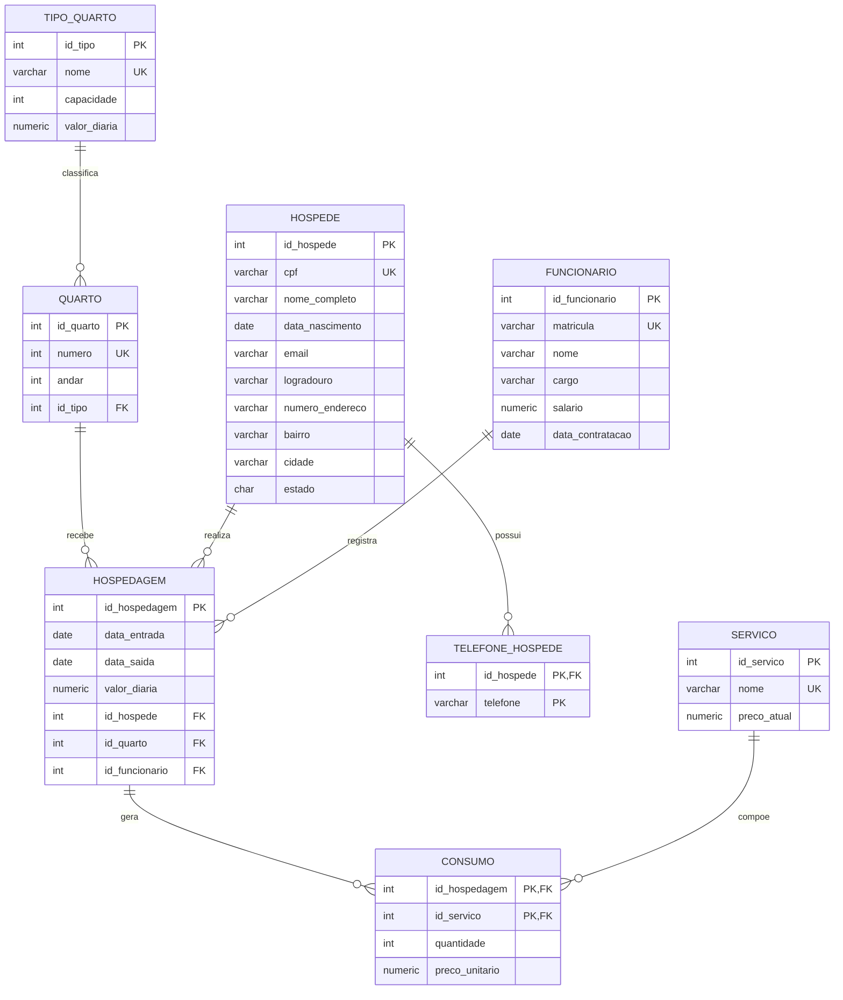

# Atividade de Revisão — Modelagem de dados e SQL

**Atividade individual**

## Objetivo

Nesta atividade você revisará os conteúdos das aulas de SQL 1 a 7:

- leitura de um modelo lógico e criação de um banco a partir de um script SQL;
- inserção e atualização de dados com `INSERT` e `UPDATE`;
- restrições de integridade: `PRIMARY KEY`, `FOREIGN KEY`, `UNIQUE`, `NOT NULL` e `CHECK`;
- comportamento de `ON DELETE RESTRICT`, `ON DELETE CASCADE`, `ON UPDATE RESTRICT` e `ON UPDATE CASCADE`;
- consultas com filtros, funções de strings e datas, ordenação e paginação;
- consultas com `INNER JOIN`, funções de agregação, `GROUP BY`, `HAVING` e subconsultas;
- consultas com junções externas: `LEFT JOIN` e `RIGHT JOIN`.

## Como executar a atividade

1. Crie no Aiven um banco novo chamado `pousada` e conecte-se a ele pelo DBeaver.
2. Execute o script da [seção 3](#3-script-de-criação-do-banco) para criar as tabelas.
3. Resolva as partes na ordem indicada. As partes 1 e 2 usam os dados que você mesmo vai inserir.
4. Execute um comando por vez e confira o resultado com `SELECT`. Quando um comando falhar, leia a mensagem do banco antes de prosseguir.
5. Os identificadores são gerados por colunas `SERIAL`. Os enunciados se referem aos registros pelos dados do domínio (por exemplo, o nome do hóspede). Consulte com `SELECT` o identificador gerado sempre que precisar dele.
6. Antes de iniciar a parte 3, execute o script de carga da [seção 6](#6-parte-3--consultas), que apaga os dados das partes anteriores e carrega os dados usados nas consultas.

## 1. Cenário: Pousada Vento Sul

A Pousada Vento Sul, um empreendimento familiar fictício do litoral capixaba, controla suas hospedagens em planilhas e decidiu passar a usar um banco de dados relacional.

A pousada classifica seus quartos em **tipos**, como Standard, Luxo e Família. De cada tipo de quarto deseja-se saber o nome, que não se repete, a capacidade de pessoas e o valor atual da diária. Um tipo pode estar cadastrado mesmo que ainda não existam quartos dele. Cada **quarto** pertence a exatamente um tipo e possui um número, que não se repete, e o andar em que está localizado.

Dos **hóspedes** deseja-se saber o nome completo, o CPF, que não se repete, a data de nascimento, o e-mail, que é opcional, e o endereço, formado por logradouro, número, bairro, cidade e estado. Um hóspede pode informar vários **telefones** ou nenhum. Os telefones só interessam à pousada enquanto o hóspede estiver cadastrado.

Dos **funcionários** deseja-se saber a matrícula, que não se repete, o nome, o cargo, o salário e a data de contratação. O cargo pode ficar em branco enquanto o funcionário ainda não tiver uma função definida.

Cada **hospedagem** é a permanência de um hóspede em um quarto. Sobre ela registram-se a data de entrada, a data de saída e o funcionário responsável pelo registro. Enquanto o hóspede estiver na pousada, a data de saída fica em branco. Quando informada, ela não pode ser anterior à data de entrada. Como a diária de um tipo de quarto pode mudar ao longo do tempo, cada hospedagem guarda o valor de diária contratado naquele momento, preservando o dado histórico.

A pousada também oferece **serviços** extras, como lavanderia e passeio de barco. Cada serviço tem um nome, que não se repete, e um preço atual. Durante uma hospedagem o hóspede pode consumir vários serviços, e um mesmo serviço pode ser consumido em várias hospedagens. Para cada **consumo** registram-se a quantidade total e o preço unitário cobrado naquela hospedagem. Um mesmo serviço aparece no máximo uma vez em cada hospedagem: um novo consumo do mesmo serviço aumenta a quantidade já registrada.

A administração definiu as seguintes regras para a exclusão de dados:

- os telefones de um hóspede devem ser excluídos junto com o hóspede;
- os consumos de uma hospedagem devem ser excluídos junto com a hospedagem;
- não se pode excluir hóspede, quarto ou funcionário que tenha hospedagem registrada;
- não se pode excluir tipo de quarto que tenha quartos cadastrados;
- não se pode excluir serviço que já tenha sido consumido.

## 2. Modelo lógico



Observe no modelo:

- `endereco` é um atributo composto. Suas partes são colunas da tabela `hospede`;
- `telefone_hospede` representa um atributo multivalorado, com chave primária composta;
- `consumo` é a tabela associativa do relacionamento N:N entre `hospedagem` e `servico`, e guarda os atributos desse relacionamento;
- `hospedagem.valor_diaria` e `consumo.preco_unitario` guardam dados históricos. O valor e o preço atuais ficam em `tipo_quarto.valor_diaria` e `servico.preco_atual`.

## 3. Script de criação do banco

Execute o script abaixo uma única vez, no banco `pousada`:

```sql
CREATE TABLE tipo_quarto (
    id_tipo SERIAL PRIMARY KEY,
    nome VARCHAR(40) NOT NULL UNIQUE,
    capacidade INTEGER NOT NULL
        CHECK (capacidade > 0),
    valor_diaria NUMERIC(8,2) NOT NULL
        CHECK (valor_diaria > 0)
);

CREATE TABLE quarto (
    id_quarto SERIAL PRIMARY KEY,
    numero INTEGER NOT NULL UNIQUE,
    andar INTEGER NOT NULL,
    id_tipo INTEGER NOT NULL,
    CONSTRAINT fk_quarto_tipo
        FOREIGN KEY (id_tipo)
        REFERENCES tipo_quarto (id_tipo)
        ON DELETE RESTRICT
        ON UPDATE RESTRICT
);

CREATE TABLE hospede (
    id_hospede SERIAL PRIMARY KEY,
    cpf VARCHAR(14) NOT NULL UNIQUE,
    nome_completo VARCHAR(120) NOT NULL,
    data_nascimento DATE NOT NULL,
    email VARCHAR(120),
    logradouro VARCHAR(120) NOT NULL,
    numero_endereco VARCHAR(10) NOT NULL,
    bairro VARCHAR(80) NOT NULL,
    cidade VARCHAR(80) NOT NULL,
    estado CHAR(2) NOT NULL
);

CREATE TABLE telefone_hospede (
    id_hospede INTEGER NOT NULL,
    telefone VARCHAR(20) NOT NULL,
    PRIMARY KEY (id_hospede, telefone),
    CONSTRAINT fk_telefone_hospede
        FOREIGN KEY (id_hospede)
        REFERENCES hospede (id_hospede)
        ON DELETE CASCADE
        ON UPDATE CASCADE
);

CREATE TABLE funcionario (
    id_funcionario SERIAL PRIMARY KEY,
    matricula VARCHAR(10) NOT NULL UNIQUE,
    nome VARCHAR(120) NOT NULL,
    cargo VARCHAR(60),
    salario NUMERIC(10,2) NOT NULL
        CHECK (salario > 0),
    data_contratacao DATE NOT NULL
);

CREATE TABLE servico (
    id_servico SERIAL PRIMARY KEY,
    nome VARCHAR(80) NOT NULL UNIQUE,
    preco_atual NUMERIC(8,2) NOT NULL
        CHECK (preco_atual >= 0)
);

CREATE TABLE hospedagem (
    id_hospedagem SERIAL PRIMARY KEY,
    data_entrada DATE NOT NULL,
    data_saida DATE,
    valor_diaria NUMERIC(8,2) NOT NULL
        CHECK (valor_diaria > 0),
    id_hospede INTEGER NOT NULL,
    id_quarto INTEGER NOT NULL,
    id_funcionario INTEGER NOT NULL,
    CONSTRAINT ck_hospedagem_datas
        CHECK (data_saida IS NULL OR data_saida >= data_entrada),
    CONSTRAINT fk_hospedagem_hospede
        FOREIGN KEY (id_hospede)
        REFERENCES hospede (id_hospede)
        ON DELETE RESTRICT
        ON UPDATE CASCADE,
    CONSTRAINT fk_hospedagem_quarto
        FOREIGN KEY (id_quarto)
        REFERENCES quarto (id_quarto)
        ON DELETE RESTRICT
        ON UPDATE CASCADE,
    CONSTRAINT fk_hospedagem_funcionario
        FOREIGN KEY (id_funcionario)
        REFERENCES funcionario (id_funcionario)
        ON DELETE RESTRICT
        ON UPDATE CASCADE
);

CREATE TABLE consumo (
    id_hospedagem INTEGER NOT NULL,
    id_servico INTEGER NOT NULL,
    quantidade INTEGER NOT NULL
        CHECK (quantidade > 0),
    preco_unitario NUMERIC(8,2) NOT NULL
        CHECK (preco_unitario >= 0),
    PRIMARY KEY (id_hospedagem, id_servico),
    CONSTRAINT fk_consumo_hospedagem
        FOREIGN KEY (id_hospedagem)
        REFERENCES hospedagem (id_hospedagem)
        ON DELETE CASCADE
        ON UPDATE CASCADE,
    CONSTRAINT fk_consumo_servico
        FOREIGN KEY (id_servico)
        REFERENCES servico (id_servico)
        ON DELETE RESTRICT
        ON UPDATE CASCADE
);
```

Confira se as oito tabelas foram criadas: `tipo_quarto`, `quarto`, `hospede`, `telefone_hospede`, `funcionario`, `servico`, `hospedagem` e `consumo`.

## 4. Parte 1 — Inserindo e atualizando dados

Escreva e execute os scripts pedidos. A resposta de cada exercício é o script.

### Inserções

1. Cadastre os tipos de quarto:

   | Nome | Capacidade | Valor da diária |
   |---|---:|---:|
   | Standard | 2 | 180,00 |
   | Luxo | 2 | 290,00 |
   | Família | 4 | 350,00 |

2. Cadastre os quartos:

   | Número | Andar | Tipo |
   |---:|---:|---|
   | 101 | 1 | Standard |
   | 102 | 1 | Standard |
   | 201 | 2 | Luxo |
   | 202 | 2 | Família |

3. Cadastre os hóspedes:

   | Nome completo | CPF | Nascimento | E-mail | Logradouro | Número | Bairro | Cidade | Estado |
   |---|---|---|---|---|---|---|---|---|
   | Ana Beatriz Souza | 111.222.333-44 | 12/05/1990 | ana.souza@email.com | Rua das Palmeiras | 120 | Centro | Vitória | ES |
   | Bruno Henrique Lima | 222.333.444-55 | 03/11/1985 | não informado | Avenida Beira Mar | 850 | Praia do Morro | Guarapari | ES |
   | Carla Mendes | 333.444.555-66 | 20/02/1978 | carla.mendes@email.com | Rua do Sol | 45 | Savassi | Belo Horizonte | MG |

4. Cadastre os telefones `(27) 99999-1111` e `(27) 98888-2222` para Ana Beatriz Souza e o telefone `(31) 97777-3333` para Carla Mendes. Não cadastre telefone para Bruno Henrique Lima.

5. Cadastre os funcionários e os serviços:

   | Matrícula | Nome | Cargo | Salário | Contratação |
   |---|---|---|---:|---|
   | M001 | Daniela Rocha | Recepcionista | 2.400,00 | 01/03/2021 |
   | M002 | Eduardo Alves | Gerente | 5.200,00 | 15/08/2018 |

   | Serviço | Preço atual |
   |---|---:|
   | Lavanderia | 45,00 |
   | Massagem relaxante | 120,00 |
   | Passeio de barco | 95,00 |

6. Registre as duas hospedagens abaixo, ambas pela funcionária Daniela Rocha. O valor contratado é o valor atual da diária do tipo do quarto.

   | Hóspede | Quarto | Entrada | Saída |
   |---|---:|---|---|
   | Ana Beatriz Souza | 201 | 10/07/2026 | 14/07/2026 |
   | Bruno Henrique Lima | 101 | 30/10/2026 | ainda hospedado |

7. Registre os consumos, cobrando o preço atual de cada serviço:

   | Hospedagem de | Serviço | Quantidade |
   |---|---|---:|
   | Ana Beatriz Souza | Lavanderia | 2 |
   | Ana Beatriz Souza | Massagem relaxante | 1 |
   | Bruno Henrique Lima | Passeio de barco | 2 |

### Atualizações

8. Bruno Henrique Lima pediu para trocar de quarto. Altere a hospedagem dele do quarto 101 para o quarto 102.

9. Bruno Henrique Lima deixou a pousada em 03/11/2026. Registre a saída.

10. Ana Beatriz Souza mudou-se para a Rua dos Ipês, número 300, no bairro Jardim Camburi, na mesma cidade. Atualize o endereço dela em um único comando.

11. Ana Beatriz Souza usou a lavanderia mais uma vez durante a hospedagem de julho. Aumente em 1 a quantidade desse consumo, sem informar diretamente o valor final.

12. A diária dos quartos Luxo foi reajustada em 10%. Atualize o valor atual desse tipo, sem informar diretamente o novo valor. Depois consulte a hospedagem de Ana Beatriz Souza e responda em um comentário: o valor da diária dessa hospedagem mudou? Por que o modelo guarda o valor da diária também na hospedagem?

13. A gerência concedeu 5% de desconto na diária contratada de todas as hospedagens realizadas em quartos do tipo Luxo. O tipo deve ser identificado pelo nome e o comando deve usar a relação entre as tabelas.

## 5. Parte 2 — Restrições de integridade

Os exercícios abaixo testam o que o banco faz diante de cada operação. Alguns comandos falham e outros funcionam, e os dois resultados fazem parte da atividade.

Em cada exercício, a resposta deve ter o script executado e, em comentários, a mensagem retornada pelo banco e sua explicação: o que aconteceu e por quê. Cite a restrição, as tabelas envolvidas e, quando houver, a regra `ON DELETE` ou `ON UPDATE` aplicada. Quando o exercício pedir uma verificação, inclua também o `SELECT` usado e o que ele mostrou.

Execute os exercícios na ordem: cada um depende do estado deixado pelos anteriores.

### Violando restrições com INSERT e UPDATE

14. Tente cadastrar o quarto 301, no andar 3, informando um tipo de quarto com identificador `999`, que não existe.

15. Tente registrar para a hospedagem de Ana Beatriz Souza o consumo de um serviço com identificador `999`, que não existe.

16. Tente alterar a hospedagem de Ana Beatriz Souza para um quarto com identificador `999`, que não existe.

17. Tente cadastrar um novo hóspede usando o CPF de Carla Mendes, preenchendo os demais campos obrigatórios com dados à sua escolha.

18. Tente registrar novamente o consumo de Lavanderia na hospedagem de Ana Beatriz Souza, com quantidade 1. Qual é a diferença entre a restrição violada aqui e a violada no exercício anterior?

19. Tente cadastrar um hóspede sem informar o nome completo.

20. Tente alterar a data de saída da hospedagem de Ana Beatriz Souza para 01/07/2026, anterior à data de entrada.

### ON DELETE RESTRICT e ON DELETE CASCADE

21. Tente excluir o tipo de quarto Standard.

22. Tente excluir o serviço Lavanderia.

23. Exclua o quarto 202. Depois exclua o tipo de quarto Família. Compare com o exercício 21: as chaves estrangeiras envolvidas também usam `ON DELETE RESTRICT`. Por que aqui os comandos funcionaram?

24. Consulte os telefones de Carla Mendes e, em seguida, exclua essa hóspede. Consulte novamente a tabela `telefone_hospede`. O que aconteceu com os telefones dela?

25. Tente excluir a hóspede Ana Beatriz Souza. Em seguida, consulte os telefones dela. Eles foram excluídos? Considerando que a chave estrangeira de `telefone_hospede` usa `CASCADE`, explique o resultado.

26. Consulte os consumos da hospedagem de Ana Beatriz Souza e, em seguida, exclua essa hospedagem. Consulte novamente as tabelas `consumo` e `servico`. O que aconteceu em cada uma? A tabela `consumo` tem duas chaves estrangeiras: explique por que excluir uma hospedagem remove os consumos, enquanto excluir um serviço consumido não é permitido.

27. Repita o exercício 22, tentando excluir o serviço Lavanderia. O resultado mudou? Por quê?

28. Repita o exercício 25, tentando excluir a hóspede Ana Beatriz Souza. O resultado mudou? O que aconteceu com os telefones dela?

### ON UPDATE RESTRICT e ON UPDATE CASCADE

29. Tente alterar para `50` o identificador do tipo de quarto Standard.

30. Altere para `200` o identificador do hóspede Bruno Henrique Lima. Depois consulte a hospedagem dele e verifique o valor de `id_hospede`. Explique por que a alteração foi aceita aqui e rejeitada no exercício anterior.

### Reflexão

31. Responda em comentários, com suas palavras:

    a) Qual é a diferença entre `ON DELETE RESTRICT` e `ON DELETE CASCADE`?

    b) Se a chave estrangeira entre `hospedagem` e `hospede` fosse `ON DELETE CASCADE`, o que aconteceria ao excluir um hóspede que tem hospedagens com consumos? Por que isso seria ruim para a pousada?

    c) Por que `CASCADE` é adequado entre `hospede` e `telefone_hospede`?

## 6. Parte 3 — Consultas

### Preparando o banco

Execute o script abaixo uma única vez, depois de terminar as partes 1 e 2. O primeiro comando apaga os dados de todas as tabelas e reinicia as sequências `SERIAL`, de forma que todos trabalhem com os mesmos dados e identificadores.

```sql
TRUNCATE TABLE consumo, hospedagem, servico, funcionario,
               telefone_hospede, hospede, quarto, tipo_quarto
RESTART IDENTITY;

INSERT INTO tipo_quarto (nome, capacidade, valor_diaria)
VALUES
    ('Standard', 2, 180.00),
    ('Luxo', 2, 290.00),
    ('Família', 4, 350.00),
    ('Suíte Master', 2, 520.00);

INSERT INTO quarto (numero, andar, id_tipo)
VALUES
    (101, 1, 1),
    (102, 1, 1),
    (103, 1, 1),
    (201, 2, 2),
    (202, 2, 2),
    (203, 2, 3),
    (301, 3, 3),
    (302, 3, 2),
    (303, 3, 1);

INSERT INTO hospede (cpf, nome_completo, data_nascimento, email, logradouro,
                     numero_endereco, bairro, cidade, estado)
VALUES
    ('111.222.333-44', 'Ana Beatriz Souza', '1990-05-12', 'ana.souza@email.com', 'Rua das Palmeiras', '120', 'Centro', 'Vitória', 'ES'),
    ('222.333.444-55', 'Bruno Henrique Lima', '1985-11-03', NULL, 'Avenida Beira Mar', '850', 'Praia do Morro', 'Guarapari', 'ES'),
    ('333.444.555-66', 'Carla Mendes', '1978-02-20', 'carla.mendes@email.com', 'Rua do Sol', '45', 'Savassi', 'Belo Horizonte', 'MG'),
    ('444.555.666-77', 'Diego Silva Ramos', '1995-08-30', 'diego.ramos@email.com', 'Rua Goiás', '310', 'Itapuã', 'Vila Velha', 'ES'),
    ('555.666.777-88', 'Elisa Ferreira', '1982-01-17', 'elisa.ferreira@email.com', 'Rua Voluntários da Pátria', '77', 'Botafogo', 'Rio de Janeiro', 'RJ'),
    ('666.777.888-99', 'Fábio Silva', '1970-06-25', NULL, 'Rua Augusta', '1500', 'Consolação', 'São Paulo', 'SP'),
    ('777.888.999-00', 'Gabriela Nunes Silveira', '1999-12-08', 'gabi.silveira@email.com', 'Rua da Bahia', '902', 'Lourdes', 'Belo Horizonte', 'MG'),
    ('888.999.000-11', 'Hugo Martins', '1988-03-14', 'hugo.martins@email.com', 'Avenida Central', '210', 'Laranjeiras', 'Serra', 'ES'),
    ('999.000.111-22', 'Isabela Costa', '1993-09-05', NULL, 'Rua Halfeld', '66', 'Centro', 'Juiz de Fora', 'MG'),
    ('000.111.222-33', 'João Pedro Araújo', '2001-04-22', 'joao.araujo@email.com', 'Rua Chapot Presvot', '150', 'Praia do Canto', 'Vitória', 'ES'),
    ('101.202.303-40', 'Karina Oliveira', '1975-07-19', 'karina.oliveira@email.com', 'Rua Barão de Jaguara', '480', 'Centro', 'Campinas', 'SP'),
    ('202.303.404-51', 'Lucas da Silva', '1997-10-11', NULL, 'Rua Geraldo Pereira', '33', 'Maria das Graças', 'Colatina', 'ES');

INSERT INTO telefone_hospede (id_hospede, telefone)
VALUES
    (1, '(27) 99999-1111'),
    (1, '(27) 98888-2222'),
    (2, '(27) 99111-2030'),
    (3, '(31) 97777-3333'),
    (4, '(27) 99222-4050'),
    (4, '(27) 3322-1100'),
    (5, '(21) 98123-4567'),
    (7, '(31) 99456-7788'),
    (8, '(27) 99333-6070'),
    (10, '(27) 99444-8090'),
    (10, '(27) 3225-4400'),
    (11, '(19) 99765-4321');

INSERT INTO funcionario (matricula, nome, cargo, salario, data_contratacao)
VALUES
    ('M001', 'Daniela Rocha', 'Recepcionista', 2400.00, '2021-03-01'),
    ('M002', 'Eduardo Alves', 'Gerente', 5200.00, '2018-08-15'),
    ('M003', 'Fernanda Dias', 'Recepcionista', 2550.00, '2023-06-12'),
    ('M004', 'Gustavo Pires', 'Camareiro', 1900.00, '2025-02-03'),
    ('M005', 'Helena Moraes', NULL, 2000.00, '2026-09-01'),
    ('M006', 'Igor Prado', 'Camareiro', 1900.00, '2024-04-22');

INSERT INTO servico (nome, preco_atual)
VALUES
    ('Lavanderia', 45.00),
    ('Massagem relaxante', 120.00),
    ('Passeio de barco', 95.00),
    ('Café da manhã no quarto', 35.00),
    ('Aluguel de bicicleta', 30.00),
    ('Traslado do aeroporto', 80.00),
    ('Massagem com pedras quentes', 160.00),
    ('Aula de surfe', 110.00);

INSERT INTO hospedagem (data_entrada, data_saida, valor_diaria, id_hospede, id_quarto, id_funcionario)
VALUES
    ('2025-07-04', '2025-07-07', 160.00, 1, 1, 1),
    ('2025-07-10', '2025-07-14', 260.00, 4, 4, 1),
    ('2025-09-05', '2025-09-09', 310.00, 5, 6, 3),
    ('2025-12-20', '2025-12-27', 260.00, 1, 4, 2),
    ('2025-12-26', '2025-12-29', 160.00, 2, 2, 1),
    ('2026-01-03', '2026-01-10', 350.00, 3, 7, 3),
    ('2026-01-08', '2026-01-11', 180.00, 6, 1, 1),
    ('2026-01-15', '2026-01-18', 290.00, 8, 5, 1),
    ('2026-01-22', '2026-01-25', 180.00, 4, 2, 3),
    ('2026-02-13', '2026-02-18', 290.00, 1, 5, 2),
    ('2026-02-14', '2026-02-17', 180.00, 7, 3, 3),
    ('2026-03-28', '2026-04-02', 350.00, 9, 6, 1),
    ('2026-04-17', '2026-04-20', 180.00, 10, 1, 1),
    ('2026-05-01', '2026-05-05', 290.00, 5, 4, 3),
    ('2026-06-10', '2026-06-14', 290.00, 3, 5, 1),
    ('2026-07-02', '2026-07-09', 350.00, 1, 7, 3),
    ('2026-07-15', '2026-07-20', 350.00, 8, 6, 1),
    ('2026-07-18', '2026-07-21', 180.00, 2, 3, 1),
    ('2026-08-07', '2026-08-10', 290.00, 4, 4, 3),
    ('2026-09-04', '2026-09-07', 270.00, 6, 5, 2),
    ('2026-10-09', '2026-10-12', 180.00, 7, 1, 1),
    ('2026-10-23', '2026-10-26', 290.00, 10, 4, 3),
    ('2026-11-01', NULL, 180.00, 5, 2, 1),
    ('2026-11-03', NULL, 350.00, 8, 7, 3);

INSERT INTO consumo (id_hospedagem, id_servico, quantidade, preco_unitario)
VALUES
    (1, 4, 3, 30.00),
    (1, 5, 2, 25.00),
    (2, 2, 1, 110.00),
    (2, 1, 1, 40.00),
    (3, 3, 4, 85.00),
    (3, 4, 4, 30.00),
    (4, 2, 2, 110.00),
    (4, 7, 1, 150.00),
    (4, 6, 2, 70.00),
    (5, 5, 2, 25.00),
    (6, 3, 5, 95.00),
    (6, 1, 2, 45.00),
    (6, 4, 7, 35.00),
    (7, 6, 1, 80.00),
    (8, 2, 2, 120.00),
    (8, 4, 3, 35.00),
    (9, 5, 3, 30.00),
    (10, 7, 2, 160.00),
    (10, 2, 1, 120.00),
    (10, 4, 5, 35.00),
    (11, 1, 1, 45.00),
    (12, 3, 4, 95.00),
    (12, 6, 2, 80.00),
    (13, 5, 2, 30.00),
    (14, 2, 1, 120.00),
    (14, 1, 2, 45.00),
    (15, 7, 1, 160.00),
    (15, 4, 4, 35.00),
    (16, 3, 3, 95.00),
    (16, 1, 3, 45.00),
    (16, 2, 1, 120.00),
    (17, 5, 4, 30.00),
    (17, 3, 2, 95.00),
    (18, 4, 3, 35.00),
    (19, 7, 1, 160.00),
    (20, 6, 1, 80.00),
    (21, 1, 1, 45.00),
    (23, 4, 2, 35.00),
    (24, 3, 2, 95.00);
```

Todos os exercícios abaixo são consultas `SELECT` e não devem alterar os dados. Quando precisar combinar tabelas, escolha o tipo de junção adequado ao que o enunciado pede.

### Filtros, funções de strings e datas

32. Selecione o nome completo dos hóspedes que têm `Silva` no nome. Atenção: `Silveira` não é `Silva`.

33. Para os hóspedes de Minas Gerais, selecione o nome completo em letras maiúsculas, a quantidade de caracteres do nome completo e a cidade e o estado em uma única coluna, no formato `Cidade - UF`.

34. Selecione o identificador e a data de entrada, no formato `DD/MM/AAAA`, das hospedagens que ainda não têm data de saída.

35. Selecione o nome e a data de contratação dos funcionários contratados há mais de três anos, considerando a data em que a consulta é executada.

### Ordenação e paginação

36. Considere uma tela que lista os hóspedes em ordem alfabética, com cinco hóspedes por página. Selecione o nome completo e o e-mail dos hóspedes da segunda página.

### Junções internas

37. Para cada hospedagem iniciada em 2026, selecione o nome do hóspede, o número do quarto, o nome do tipo do quarto, o nome do funcionário responsável e as datas de entrada e de saída. Ordene pela data de entrada.

38. Selecione a data de entrada da hospedagem, o nome do serviço, a quantidade, o preço unitário e o valor total do item (quantidade × preço unitário) de todos os consumos da hóspede `Ana Beatriz Souza`. Ordene pela data de entrada e pelo nome do serviço.

39. Selecione, sem repetição e em ordem alfabética, o nome dos hóspedes que já consumiram algum serviço cujo nome contenha `Massagem`.

40. Selecione o nome do hóspede, o número do quarto, a data de entrada, a diária contratada e o valor atual da diária do tipo do quarto, apenas das hospedagens cuja diária contratada seja diferente do valor atual.

### Funções de agregação

41. Para cada cargo informado, selecione o cargo, a quantidade de funcionários, o salário médio, o menor e o maior salário. Funcionários sem cargo não devem ser considerados. Ordene pelo salário médio, do maior para o menor.

42. Para cada serviço já consumido, selecione o nome do serviço, a quantidade total consumida e o valor total faturado (soma de quantidade × preço unitário). Ordene do maior para o menor valor faturado.

43. Selecione o identificador da hospedagem, o nome do hóspede e o total gasto em consumos, apenas das hospedagens em que esse total seja maior que 400 reais. Ordene do maior para o menor total.

44. Selecione o nome dos funcionários que registraram mais de três hospedagens iniciadas em 2026 e a quantidade dessas hospedagens.

45. Selecione o nome e a quantidade de hospedagens dos três hóspedes que mais se hospedaram na pousada. Em caso de empate, use a ordem alfabética do nome como desempate.

46. Considerando apenas as hospedagens já encerradas e iniciadas em 2026, selecione o nome de cada tipo de quarto e o total faturado em diárias, do maior para o menor total. O valor de uma hospedagem é o número de diárias multiplicado pela diária contratada. No PostgreSQL, a expressão `data_saida - data_entrada` retorna o número de dias entre as duas datas.

### Subconsultas

47. Selecione o nome e o preço atual dos serviços cujo preço é maior que o preço médio de todos os serviços. Ordene do mais caro para o mais barato.

48. Selecione o número do quarto e o nome do tipo dos quartos que nunca receberam uma hospedagem.

49. Para cada cargo informado, selecione o cargo, o nome e o salário do(s) funcionário(s) com o maior salário daquele cargo. Se houver empate, apresente todos os empatados. Ordene pelo cargo e pelo nome.

50. Para cada hóspede que já se hospedou na pousada, selecione o nome, a data de entrada e o número do quarto da hospedagem mais recente dele. Ordene pelo nome do hóspede.

51. Selecione o nome de cada tipo de quarto cuja média de diárias contratadas seja maior que a média das diárias contratadas de todas as hospedagens, junto com essa média.

### Junções externas

52. Selecione o nome de todos os tipos de quarto e, quando houver, o número dos quartos de cada tipo. Os tipos sem quartos também devem aparecer. Ordene pelo nome do tipo e pelo número do quarto.

53. Usando `RIGHT JOIN`, selecione o nome completo de todos os hóspedes e, quando houver, seus telefones. Os hóspedes sem telefone também devem aparecer. Ordene pelo nome do hóspede e pelo telefone.

54. Refaça o exercício 48 usando `LEFT JOIN` em vez de subconsulta.

55. Selecione o identificador da hospedagem, a data de entrada e o nome do hóspede das hospedagens que não têm nenhum consumo registrado.

56. Para cada funcionário, selecione o nome e a quantidade de hospedagens que ele registrou. Os funcionários que não registraram hospedagens devem aparecer com quantidade zero. Ordene da maior para a menor quantidade e, em caso de empate, pelo nome.

57. Para cada serviço, selecione o nome, a quantidade total consumida e o valor total faturado (soma de quantidade × preço unitário). Os serviços nunca consumidos também devem aparecer. Ordene pelo nome do serviço.

58. Para cada hóspede, selecione o nome completo e o total gasto em consumos, somando todas as suas hospedagens. Os hóspedes que nunca se hospedaram também devem aparecer. Ordene pelo nome do hóspede.

59. Selecione o nome completo e a quantidade de hospedagens dos hóspedes com menos de duas hospedagens, incluindo os que nunca se hospedaram. Ordene pelo nome do hóspede.

60. Considerando apenas as hospedagens iniciadas em 2025, selecione o nome completo de todos os hóspedes e a quantidade dessas hospedagens. Os hóspedes sem hospedagem iniciada em 2025 devem aparecer com quantidade zero. Ordene da maior para a menor quantidade e, em caso de empate, pelo nome.

## 7. Entrega

Entregue um único arquivo com extensão `.sql`, contendo as respostas dos 60 exercícios na mesma ordem desta atividade. Para cada questão, inclua o número e o enunciado em um comentário SQL, seguidos do script. Nas questões que pedem explicação, inclua em comentários a mensagem do banco e sua resposta. Por exemplo:

```sql
-- 14. Tente cadastrar o quarto 301, no andar 3, informando um tipo de quarto com identificador 999, que não existe.
INSERT INTO ...;
-- Mensagem do banco: ...
-- O que aconteceu e por quê: ...
```

**Bom trabalho!**
