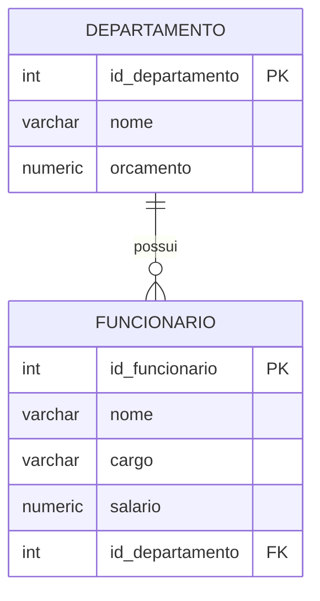

# Aula 1 — SQL-DML: inserindo, consultando, alterando e removendo dados

Nesta aula vamos começar a manipular os dados de um banco PostgreSQL. Para isso, estudaremos os comandos:

- `INSERT`, para inserir registros;
- `UPDATE`, para alterar registros;
- `DELETE`, para remover registros;
- `SELECT`, para consultar registros.

Esses comandos atuam sobre as tabelas criadas no banco. O comando `SELECT` é frequentemente estudado junto com DML, embora também seja classificado como uma operação de consulta, ou DQL (*Data Query Language*).

## Modelo usado nos exemplos

Todos os exemplos desta aula usam um modelo simples de departamentos e funcionários. Um `Departamento` pode possuir vários `Funcionarios`, mas cada funcionário pertence a um único departamento. Portanto, o relacionamento é 1:N.



O modelo possui algumas restrições para que os exemplos também mostrem como o banco reage a dados inválidos:

- as chaves primárias usam `SERIAL`;
- `nome`, `orcamento`, `salario` e `id_departamento` possuem restrição `NOT NULL` ou seja, são obrigatórios;
- `orcamento` não pode ser negativo;
- `salario` deve ser maior que zero;
- `id_departamento` é uma chave estrangeira para `departamento`;
- a exclusão de um departamento com funcionários é impedida por `ON DELETE RESTRICT`;
- alterações no identificador do departamento são impedidas enquanto houver funcionários relacionados, por `ON UPDATE RESTRICT`.

### SQL para criação do banco do modelo

Utilize este script para criar o banco de dados utilizado nos exemplos:

```sql
CREATE TABLE departamento (
    id_departamento SERIAL PRIMARY KEY,
    nome VARCHAR(80) NOT NULL,
    orcamento NUMERIC(12,2) NOT NULL
        CHECK (orcamento >= 0)
);

CREATE TABLE funcionario (
    id_funcionario SERIAL PRIMARY KEY,
    nome VARCHAR(120) NOT NULL,
    cargo VARCHAR(80),
    salario NUMERIC(10,2) NOT NULL
        CHECK (salario > 0),
    id_departamento INTEGER NOT NULL,
    CONSTRAINT fk_funcionario_departamento
        FOREIGN KEY (id_departamento)
        REFERENCES departamento (id_departamento)
        ON DELETE RESTRICT
        ON UPDATE RESTRICT
);
```

As tabelas devem ser criadas nessa ordem porque `funcionario` possui uma chave estrangeira que referencia `departamento`.

## INSERT

O comando `INSERT` cria novos registros em uma tabela. A forma mais clara de utilizá-lo é informar as colunas que receberão valores:

```sql
INSERT INTO tabela (coluna_1, coluna_2, coluna_3)
VALUES (valor_1, valor_2, valor_3);
```

### Inserindo um departamento

O identificador `id_departamento` não aparece no comando. Como ele foi definido como `SERIAL`, o PostgreSQL gera seu valor automaticamente.

```sql
INSERT INTO departamento (nome, orcamento)
VALUES ('Tecnologia', 100000.00);
```

Podemos inserir outros departamentos:

```sql
INSERT INTO departamento (nome, orcamento)
VALUES
    ('Recursos Humanos', 45000.00),
    ('Financeiro', 70000.00);
```

### SELECT básico para visualizar os dados inseridos

O comando abaixo exibe todas as colunas e todos os registros da tabela:

```sql
SELECT * FROM departamento;
```

Em um banco recém-criado, os identificadores provavelmente serão 1, 2 e 3, criados pelo SGBD.

### Inserindo funcionários

Considerando que o departamento de Tecnologia recebeu o identificador 1, podemos inserir funcionários associados a ele:

```sql
INSERT INTO funcionario (nome, cargo, salario, id_departamento)
VALUES
    ('Ana Souza', 'Desenvolvedora', 6500.00, 1),
    ('Bruno Lima', 'Analista', 5200.00, 1);
```

Agora podemos verificar o resultado:

```sql
SELECT * FROM funcionario;
```

Também é possível consultar somente algumas colunas:

```sql
SELECT nome, cargo, salario
FROM funcionario;
```

### O campo SERIAL

`SERIAL` é uma forma prática do PostgreSQL criar uma coluna inteira com um valor padrão obtido de uma sequência. Ele é muito usado em exemplos para chaves primárias artificiais.

O procedimento normal é omitir a coluna `SERIAL` do `INSERT`:

```sql
INSERT INTO departamento (nome, orcamento)
VALUES ('Operações', 30000.00);
```

O banco gera o próximo `id_departamento` disponível na sequência.

Embora o PostgreSQL permita informar manualmente um valor para uma coluna `SERIAL`, isso deve ser evitado:

```sql
INSERT INTO departamento (id_departamento, nome, orcamento)
VALUES (100, 'Projeto Especial', 15000.00);
```

Esse comando pode funcionar se o valor 100 ainda não existir. Porém, a sequência usada pelo `SERIAL` não é necessariamente atualizada para 100. Em inserções futuras, ela pode gerar um valor já utilizado manualmente, causando erro de chave primária. Se o valor informado já existir, o banco rejeitará o `INSERT` por violação da `PRIMARY KEY`.

### Restrições de integridade no INSERT

As restrições verificam se o novo registro respeita as regras do modelo.

#### Violação de NOT NULL

`nome` é obrigatório em `funcionario`. O exemplo abaixo não informa esse campo:

```sql
INSERT INTO funcionario (cargo, salario, id_departamento)
VALUES ('Estagiário', 1800.00, 1);
```

O banco rejeita o comando porque `nome` não pode receber `NULL`.

#### Violação de CHECK

`salario` precisa ser maior que zero (no script de definição da tabela há uma restrição CHECK (salario > 0)):

```sql
INSERT INTO funcionario (nome, cargo, salario, id_departamento)
VALUES ('Carlos Mendes', 'Assistente', 0.00, 2);
```

O banco rejeita o registro porque a condição `salario > 0` foi violada. O mesmo ocorre com um orçamento negativo:

```sql
INSERT INTO departamento (nome, orcamento)
VALUES ('Departamento Inválido', -1.00);
```

#### Violação de FOREIGN KEY

O departamento 999 não existe no modelo de exemplo:

```sql
INSERT INTO funcionario (nome, cargo, salario, id_departamento)
VALUES ('Daniel Alves', 'Analista', 4000.00, 999);
```

O banco rejeita o `INSERT` porque `funcionario.id_departamento` precisa referenciar um registro existente em `departamento.id_departamento`.

## DELETE

O comando `DELETE` remove registros de uma tabela:

```sql
DELETE FROM tabela
WHERE condição;
```

### Removendo um funcionário

Para remover um funcionário específico, filtramos pela chave primária:

```sql
DELETE FROM funcionario
WHERE id_funcionario = 2;
```

Depois, podemos verificar o resultado:

```sql
SELECT * FROM funcionario;
```

O `WHERE` é fundamental. Sem ele, todos os registros da tabela seriam removidos:

```sql
-- Evite executar sem ter certeza:
DELETE FROM funcionario;
```

Esse comando não remove a tabela nem sua estrutura, mas apaga todas as suas linhas.

### Efeito da FOREIGN KEY ao excluir um departamento

O departamento de Tecnologia possui funcionários. Por isso, a tentativa abaixo é rejeitada:

```sql
DELETE FROM departamento
WHERE id_departamento = 1;
```

A restrição `ON DELETE RESTRICT` impede a exclusão enquanto houver funcionários apontando para esse departamento. Isso evita que existam funcionários associados a um departamento que não existe.

Para excluir o departamento, seria necessário primeiro transferir ou remover seus funcionários, de acordo com a regra de negócio.Quando falarmos do comando update veremos como poderíamos transferir os funcionários de departamento. O script abaixo apaga os funcionários do departamento 1 para depois excluí-lo:

```sql
DELETE FROM funcionario
WHERE id_departamento = 1;

DELETE FROM departamento
WHERE id_departamento = 1;
```

### Principais ações de exclusão

O comportamento de uma chave estrangeira pode ser definido pela cláusula `ON DELETE`:

| Ação | Comportamento |
|---|---|
| `RESTRICT` | Impede imediatamente a exclusão do registro pai enquanto houver filhos. A verificação não pode ser adiada. |
| `NO ACTION` | Também impede a exclusão se ainda houver filhos, mas a verificação pode ocorrer ao fim da transação. Sem adiamento, o resultado prático é semelhante ao `RESTRICT`. |
| `CASCADE` | Exclui automaticamente os registros filhos. |
| `SET NULL` | Mantém os filhos, mas coloca a FK como `NULL`; a coluna precisa aceitar `NULL`. |
| `SET DEFAULT` | Substitui a FK pelo valor padrão definido para a coluna. |

Por exemplo, se a FK fosse definida assim:

```sql
FOREIGN KEY (id_departamento)
REFERENCES departamento (id_departamento)
ON DELETE CASCADE
```

ao excluir um departamento, todos os funcionários associados a ele também seriam excluídos. Essa decisão só deve ser usada quando a regra de negócio realmente determinar esse comportamento.

Já `SET NULL` não pode ser usado na tabela desta aula sem alterar a coluna, pois `id_departamento` foi definido como `NOT NULL`:

```sql
-- Esta combinação seria incompatível com id_departamento NOT NULL:
ON DELETE SET NULL
```

## UPDATE

O comando `UPDATE` altera valores de registros existentes:

```sql
UPDATE tabela
SET coluna_1 = novo_valor,
    coluna_2 = outro_valor
WHERE condição;
```

### Alterando o salário de um funcionário

```sql
UPDATE funcionario
SET salario = 7000.00
WHERE id_funcionario = 1;
```

Verifique a alteração:

```sql
SELECT *
FROM funcionario
WHERE id_funcionario = 1;
```

Também podemos alterar o cargo e o departamento de um funcionário:

```sql
UPDATE funcionario
SET cargo = 'Desenvolvedora Sênior',
    id_departamento = 2
WHERE id_funcionario = 1;
```

O novo departamento precisa existir. Caso contrário, a alteração será rejeitada pela `FOREIGN KEY`.

### A importância do WHERE no UPDATE

O `WHERE` informa quais registros devem ser alterados. Sem ele, todos os funcionários receberiam o mesmo salário:

```sql
-- Não execute sem intenção de alterar todos os registros:
UPDATE funcionario
SET salario = 3000.00;
```

Antes de executar um `UPDATE`, é recomendável executar um `SELECT` usando a mesma condição:

```sql
SELECT *
FROM funcionario
WHERE cargo = 'Analista';
```

Se os registros retornados forem os que devem ser alterados, podemos executar:

```sql
UPDATE funcionario
SET salario = salario * 1.10
WHERE cargo = 'Analista';
```

### Restrições no UPDATE

As mesmas restrições que foram aplicadas no `INSERT` também são verificadas no `UPDATE`.

Salário negativo viola o `CHECK`:

```sql
UPDATE funcionario
SET salario = -100.00
WHERE id_funcionario = 1;
```

Departamento inexistente viola a `FOREIGN KEY`:

```sql
UPDATE funcionario
SET id_departamento = 999
WHERE id_funcionario = 1;
```

O banco rejeita as operações para preservar a integridade dos dados.

### ON UPDATE RESTRICT e ON UPDATE CASCADE

O script desta aula usa:

```sql
ON UPDATE RESTRICT
```

Essa ação impede a alteração do identificador de um departamento enquanto existirem funcionários apontando para ele. Por exemplo, a tentativa abaixo será rejeitada se o departamento 1 possuir funcionários:

```sql
UPDATE departamento
SET id_departamento = 10
WHERE id_departamento = 1;
```

Uma alternativa seria definir a chave estrangeira com:

```sql
ON UPDATE CASCADE
```

Nesse caso, se o identificador do departamento 1 fosse alterado para 10, o banco atualizaria automaticamente `funcionario.id_departamento` de 1 para 10. Assim, as referências continuariam válidas.

É importante não confundir essa situação com a alteração direta da chave estrangeira do funcionário. O comando abaixo continua inválido mesmo com `ON UPDATE CASCADE`, pois o departamento 999 não existe:

```sql
UPDATE funcionario
SET id_departamento = 999
WHERE id_funcionario = 1;
```

O `CASCADE` não cria o registro pai nem autoriza uma referência inexistente; ele apenas propaga uma alteração válida feita na chave referenciada. Como identificadores artificiais normalmente não precisam ser alterados, `ON UPDATE RESTRICT` é uma escolha conservadora para impedir alterações acidentais nas chaves primárias.

### Clausula WHERE

O `WHERE` filtra consultas, deleções e atualizações. No caso de uso com SELECT, ele apenas define quais linhas serão exibidas.

Todos os funcionários:

```sql
SELECT *
FROM funcionario;
```

Somente funcionários com salário maior que 5000:

```sql
SELECT nome, cargo, salario
FROM funcionario
WHERE salario > 5000;
```

Funcionários de um departamento específico:

```sql
SELECT nome, cargo
FROM funcionario
WHERE id_departamento = 1;
```

Condições podem ser combinadas no WHERE (em SELECT, UPDATE e DELETE):

```sql
SELECT nome, cargo, salario
FROM funcionario
WHERE salario >= 4000
  AND cargo = 'Analista';
```

```sql
UPDATE funcionario
SET salario = salario * 0.9
WHERE cargo = 'Analista'
  AND salario >= 4000;
```
```sql
DELETE FROM funcionario
WHERE cargo = 'Analista'
  AND salario >= 4000;
```


## Resumo da aula

| Comando | Finalidade | Cuidado principal |
|---|---|---|
| `INSERT` | Insere registros. | Respeitar `NOT NULL`, `CHECK`, PKs e FKs. |
| `SELECT` | Consulta registros. | Usar `WHERE` para filtrar o resultado. |
| `UPDATE` | Altera registros. | Nunca esquecer o `WHERE` quando a alteração não for geral. |
| `DELETE` | Remove registros. | Verificar o `WHERE` e os efeitos das FKs. |

Os comandos DML permitem manipular os dados, mas o banco também aplica as restrições definidas no modelo físico. Essas restrições são importantes porque impedem registros incompletos, valores inválidos e referências a entidades inexistentes.

## Atividade

Para praticar os conteúdos desta aula, realize a [Atividade 1 — SQL](aula1_sql_atividades.md).
