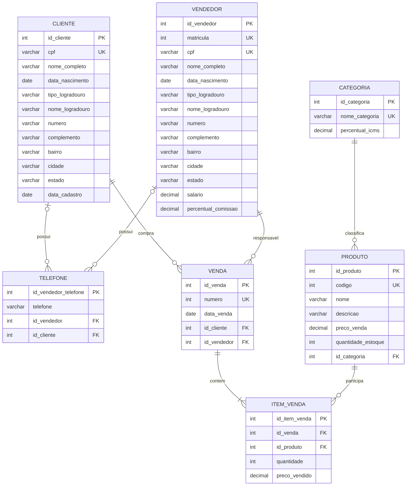

# Atividade — SQL-DML 1

**Atividade individual**

## Objetivo

Nesta atividade você praticará os comandos `INSERT`, `SELECT`, `UPDATE` e `DELETE`, além de observar como as restrições de integridade do banco impedem operações inválidas.

Será utilizado o banco de dados construído na **Dinâmica 4**, sobre uma loja varejista. O banco será criado no PostgreSQL usando o DBeaver.

## Como executar a atividade

1. Execute as tarefas em um banco novo chamado `Loja`.
2. Execute cada comando separadamente e confira o resultado com `SELECT`.
3. O script usa colunas `SERIAL`. Considerando um banco vazio e a ordem indicada nesta atividade, os primeiros identificadores gerados serão 1, 2 e 3, conforme indicado nos comandos seguintes.
4. Nas tarefas que solicitam uma explicação, registre a mensagem apresentada pelo PostgreSQL e identifique a tabela e a chave estrangeira envolvidas.

## 1. Modelo lógico da Dinâmica 4

O modelo lógico possui as tabelas `cliente`, `vendedor`, `categoria`, `produto`, `venda`, `telefone` e `item_venda`.

- As chaves primárias são artificiais.
- `cpf`, `matricula`, `codigo`, `nome_categoria` e `numero` são identificadores de domínio e possuem restrição `UNIQUE`.
- `telefone` armazena os telefones de clientes e vendedores.
- `item_venda` resolve o relacionamento N:N entre `venda` e `produto`, armazenando também a quantidade e o preço praticado na venda.



## 2. Tarefa 1 — criar o banco e as tabelas

No DBeaver, conecte-se ao servidor PostgreSQL e crie um banco de dados chamado `Loja`. Depois, abra uma conexão com esse banco e execute o script abaixo.

Após conectar-se ao banco `Loja`, execute o script de criação das tabelas:

```sql
-- Modelo físico da Loja Varejista

CREATE TABLE cliente (
    id_cliente SERIAL PRIMARY KEY,
    cpf VARCHAR(14) NOT NULL UNIQUE,
    nome_completo VARCHAR(120) NOT NULL,
    data_nascimento DATE NOT NULL,
    tipo_logradouro VARCHAR(30) NOT NULL,
    nome_logradouro VARCHAR(120) NOT NULL,
    numero VARCHAR(10) NOT NULL,
    complemento VARCHAR(80),
    bairro VARCHAR(80) NOT NULL,
    cidade VARCHAR(80) NOT NULL,
    estado CHAR(2) NOT NULL,
    data_cadastro DATE NOT NULL
);

CREATE TABLE vendedor (
    id_vendedor SERIAL PRIMARY KEY,
    matricula INTEGER NOT NULL UNIQUE,
    cpf VARCHAR(14) NOT NULL UNIQUE,
    nome_completo VARCHAR(120) NOT NULL,
    data_nascimento DATE NOT NULL,
    tipo_logradouro VARCHAR(30) NOT NULL,
    nome_logradouro VARCHAR(120) NOT NULL,
    numero VARCHAR(10) NOT NULL,
    complemento VARCHAR(80),
    bairro VARCHAR(80) NOT NULL,
    cidade VARCHAR(80) NOT NULL,
    estado CHAR(2) NOT NULL,
    salario NUMERIC(12,2) NOT NULL CHECK (salario >= 0),
    percentual_comissao NUMERIC(5,2) NOT NULL
        CHECK (percentual_comissao >= 0 AND percentual_comissao <= 100)
);

CREATE TABLE categoria (
    id_categoria SERIAL PRIMARY KEY,
    nome_categoria VARCHAR(80) NOT NULL UNIQUE,
    percentual_icms NUMERIC(5,2) NOT NULL
        CHECK (percentual_icms >= 0 AND percentual_icms <= 100)
);

CREATE TABLE produto (
    id_produto SERIAL PRIMARY KEY,
    codigo INTEGER NOT NULL UNIQUE,
    nome VARCHAR(120) NOT NULL,
    descricao VARCHAR(500) NOT NULL,
    preco_venda NUMERIC(12,2) NOT NULL CHECK (preco_venda >= 0),
    quantidade_estoque INTEGER NOT NULL CHECK (quantidade_estoque >= 0),
    id_categoria INTEGER NOT NULL,
    CONSTRAINT fk_produto_categoria
        FOREIGN KEY (id_categoria)
        REFERENCES categoria (id_categoria)
        ON DELETE RESTRICT
        ON UPDATE CASCADE
);

CREATE TABLE venda (
    id_venda SERIAL PRIMARY KEY,
    numero INTEGER NOT NULL UNIQUE,
    data_venda DATE NOT NULL,
    id_cliente INTEGER NOT NULL,
    id_vendedor INTEGER NOT NULL,
    CONSTRAINT fk_venda_cliente
        FOREIGN KEY (id_cliente)
        REFERENCES cliente (id_cliente)
        ON DELETE RESTRICT
        ON UPDATE CASCADE,
    CONSTRAINT fk_venda_vendedor
        FOREIGN KEY (id_vendedor)
        REFERENCES vendedor (id_vendedor)
        ON DELETE RESTRICT
        ON UPDATE CASCADE
);

CREATE TABLE telefone (
    id_vendedor_telefone SERIAL PRIMARY KEY,
    id_vendedor INTEGER,
    id_cliente INTEGER,
    telefone VARCHAR(20) NOT NULL,
    CONSTRAINT uq_vendedor_telefone
        UNIQUE (id_vendedor, telefone),
    CONSTRAINT fk_vendedor_telefone_vendedor
        FOREIGN KEY (id_vendedor)
        REFERENCES vendedor (id_vendedor)
        ON DELETE CASCADE
        ON UPDATE CASCADE,
    CONSTRAINT fk_cliente_telefone_cliente
        FOREIGN KEY (id_cliente)
        REFERENCES cliente (id_cliente)
        ON DELETE CASCADE
        ON UPDATE CASCADE
);

CREATE TABLE item_venda (
    id_item_venda SERIAL PRIMARY KEY,
    id_venda INTEGER NOT NULL,
    id_produto INTEGER NOT NULL,
    quantidade INTEGER NOT NULL CHECK (quantidade > 0),
    preco_vendido NUMERIC(12,2) NOT NULL CHECK (preco_vendido >= 0),
    CONSTRAINT uq_item_venda_produto
        UNIQUE (id_venda, id_produto),
    CONSTRAINT fk_item_venda_venda
        FOREIGN KEY (id_venda)
        REFERENCES venda (id_venda)
        ON DELETE CASCADE
        ON UPDATE CASCADE,
    CONSTRAINT fk_item_venda_produto
        FOREIGN KEY (id_produto)
        REFERENCES produto (id_produto)
        ON DELETE RESTRICT
        ON UPDATE CASCADE
);
```

Confirme no DBeaver se as sete tabelas foram criadas.

## 3. Tarefa 2 — inserir clientes

Insira exatamente os três clientes abaixo na tabela `cliente`:

```sql
INSERT INTO cliente (
    cpf, nome_completo, data_nascimento, tipo_logradouro,
    nome_logradouro, numero, complemento, bairro, cidade,
    estado, data_cadastro
)
VALUES
    ('111.222.333-44', 'Ana Souza', '1996-05-12', 'Rua',
     'das Flores', '120', 'Apto 301', 'Centro', 'Vitória',
     'ES', '2026-03-01'),
    ('222.333.444-55', 'Bruno Lima', '1991-09-27', 'Avenida',
     'Nossa Senhora da Penha', '850', 'Sala 12', 'Praia do Canto', 'Vitória',
     'ES', '2026-03-01'),
    ('333.444.555-66', 'Carla Mendes', '1985-02-18', 'Praça',
     'do Sol', '45', NULL, 'Jardim da Penha', 'Vitória',
     'ES', '2026-03-01');
```

Consulte os dados e confirme que foram gerados os identificadores `1`, `2` e `3`:

```sql
SELECT * FROM cliente ORDER BY id_cliente;
```

## 4. Tarefa 3 — inserir vendedores

Insira exatamente os dois vendedores abaixo:

```sql
INSERT INTO vendedor (
    matricula, cpf, nome_completo, data_nascimento,
    tipo_logradouro, nome_logradouro, numero, complemento,
    bairro, cidade, estado, salario, percentual_comissao
)
VALUES
    (1001, '444.555.666-77', 'Daniel Costa', '1988-03-20', 'Avenida',
     'Central', '100', 'Sala 2', 'Centro', 'Vitória', 'ES', 4500.00, 5.00),
    (1002, '555.666.777-88', 'Elisa Martins', '1992-11-08', 'Rua',
     'das Palmeiras', '210', NULL, 'Jardim Camburi', 'Vitória', 'ES', 5200.00, 7.50);
```

Verifique os vendedores:

```sql
SELECT id_vendedor, matricula, nome_completo, salario, percentual_comissao
FROM vendedor
ORDER BY id_vendedor;
```

## 5. Tarefa 4 — inserir categorias

Insira as três categorias abaixo:

```sql
INSERT INTO categoria (nome_categoria, percentual_icms)
VALUES
    ('Freios', 18.00),
    ('Motor', 12.00),
    ('Suspensão', 10.00);
```

Consulte a tabela e confirme os identificadores:

```sql
SELECT * FROM categoria;
```

## 6. Tarefa 5 — inserir produtos

Insira os três produtos abaixo. Os produtos devem referenciar as categorias 1, 2 e 3, respectivamente:

```sql
INSERT INTO produto (
    codigo, nome, descricao, preco_venda, quantidade_estoque, id_categoria
)
VALUES
    (1001, 'Pastilha de freio', 'Jogo de pastilhas para freio dianteiro',
     149.90, 20, 1),
    (1002, 'Filtro de óleo', 'Filtro de óleo para motores de passeio',
     39.90, 50, 2),
    (1003, 'Amortecedor dianteiro', 'Amortecedor dianteiro direito',
     269.90, 15, 3);
```

Agora tente inserir o produto abaixo:

```sql
INSERT INTO produto (
    codigo, nome, descricao, preco_venda, quantidade_estoque, id_categoria
)
VALUES
    (1004, 'Correia dentada', 'Correia dentada para motor',
     189.90, 10, 999);
```

O comando deve gerar erro. Explique por que o produto não pode ser inserido e indique qual chave estrangeira foi violada. Depois, confirme que somente os três primeiros produtos foram cadastrados:

```sql
SELECT * FROM produto ORDER BY id_produto;
```

## 7. Tarefa 6 — inserir telefones

Insira os telefones dos clientes e dos vendedores. Quando o telefone pertencer a um cliente, deixe `id_vendedor` como `NULL`; quando pertencer a um vendedor, deixe `id_cliente` como `NULL`.

```sql
INSERT INTO telefone (id_vendedor, id_cliente, telefone)
VALUES
    (NULL, 1, '(27) 99999-1111'),
    (NULL, 1, '(27) 98888-2222'),
    (NULL, 2, '(27) 97777-3333'),
    (1, NULL, '(27) 96666-4444'),
    (2, NULL, '(27) 95555-5555');
```

Consulte os telefones:

```sql
SELECT * FROM telefone;
```

Agora tente inserir um telefone para um cliente inexistente:

```sql
INSERT INTO telefone (id_vendedor, id_cliente, telefone)
VALUES (NULL, 999, '(27) 94444-6666');
```

Explique por que esse comando falha e qual tabela deveria conter o registro referenciado.

## 8. Tarefa 7 — criar uma venda com os scripts

Crie uma venda para a cliente **Ana Souza** (`id_cliente = 1`), realizada pelo vendedor **Daniel Costa** (`id_vendedor = 1`) em `2026-03-10`. A venda deverá receber o número `5001` e conter os seguintes itens:

- 2 unidades de **Pastilha de freio** (`id_produto = 1`), pelo preço de `149.90` cada;
- 1 unidade de **Filtro de óleo** (`id_produto = 2`), pelo preço de `39.90`.

Execute primeiro o `INSERT` da venda e depois o `INSERT` dos itens. Os scripts são:

```sql
INSERT INTO venda (numero, data_venda, id_cliente, id_vendedor)
VALUES (5001, '2026-03-10', 1, 1);
```

Como a venda foi a primeira criada, seu `id_venda` será `1` em um banco novo:

```sql
INSERT INTO item_venda (
    id_venda, id_produto, quantidade, preco_vendido
)
VALUES
    (1, 1, 2, 149.90),
    (1, 2, 1, 39.90);
```

Confira a venda e seus itens antes de continuar (fazendo selects nas tabelas venda e item_venda).

## 9. Tarefa 8 — criar outras vendas sem os scripts

Agora crie as duas vendas abaixo, escrevendo você mesmo os comandos `INSERT`. Nesta tarefa, não serão fornecidos os scripts de inserção.

### Venda 5002

- Cliente: **Bruno Lima** (`id_cliente = 2`);
- Vendedora: **Elisa Martins** (`id_vendedor = 2`);
- Data: `2026-03-11`;
- 4 unidades de **Amortecedor dianteiro** (`id_produto = 3`), pelo preço de `269.90` cada.

### Venda 5003

- Cliente: **Carla Mendes** (`id_cliente = 3`);
- Vendedor: **Daniel Costa** (`id_vendedor = 1`);
- Data: `2026-03-12`;
- 2 unidades de **Filtro de óleo** (`id_produto = 2`), pelo preço de `39.90` cada.

Para cada venda, faça o `INSERT` da venda antes do `INSERT` do respectivo item. Como as duas vendas serão criadas depois da venda 5001, seus `id_venda` deverão ser `2` e `3`, respectivamente, em um banco novo. Ao terminar, confirme que as três vendas e seus itens foram cadastrados.

## 10. Tarefa 9 — consultas de conferência

Execute as consultas abaixo, sempre consultando uma única tabela por vez, e interprete os resultados.

### Clientes

```sql
SELECT
    id_cliente,
    cpf,
    nome_completo,
    cidade,
    estado
FROM cliente
ORDER BY id_cliente;
```

### Telefones cadastrados para clientes

```sql
SELECT
    id_vendedor_telefone,
    id_cliente,
    telefone
FROM telefone
WHERE id_cliente IS NOT NULL
ORDER BY id_cliente, telefone;
```
Pelos resultados dos 2 ultimos scripts vc consegue saber o nome e o(s) telefone(s) de cada cliente?

### Categorias

```sql
SELECT
    id_categoria,
    nome_categoria,
    percentual_icms
FROM categoria
ORDER BY id_categoria;
```

### Produtos

```sql
SELECT
    id_produto,
    codigo,
    nome,
    preco_venda,
    quantidade_estoque,
    id_categoria
FROM produto
ORDER BY id_produto;
```
Pelos resultados dos 2 ultimos scripts vc consegue saber o nome do produto e o nome da categoria de cada produto?

### Vendas

```sql
SELECT
    id_venda,
    numero,
    data_venda,
    id_cliente,
    id_vendedor
FROM venda
ORDER BY id_venda;
```

### Itens das vendas

```sql
SELECT
    id_item_venda,
    id_venda,
    id_produto,
    quantidade,
    preco_vendido
FROM item_venda
ORDER BY id_item_venda;
```

Pelos resultados dos 2 ultimos scripts vc consegue saber o numero da venda e os produtos vendidos cada venda?


Cada consulta desta tarefa usa somente uma tabela. No futuro, esses scripts serão evoluídos quando aprendermos a fazer consultas envolvendo mais de uma tabela.

## 11. Tarefa 10 — alterações com UPDATE

### 11.1 Alterações válidas

Altere o preço e o estoque do produto de código `1001`:

```sql
UPDATE produto
SET preco_venda = 159.90,
    quantidade_estoque = 18
WHERE codigo = 1001;
```

Altere a comissão do vendedor de matrícula `1002`:

```sql
UPDATE vendedor
SET percentual_comissao = 8.00
WHERE matricula = 1002;
```

Confira as duas alterações:

```sql
SELECT codigo, nome, preco_venda, quantidade_estoque
FROM produto
WHERE codigo = 1001;

SELECT matricula, nome_completo, percentual_comissao
FROM vendedor
WHERE matricula = 1002;
```

### 11.2 UPDATE que viola integridade referencial

Tente associar a venda 5002 a um vendedor inexistente:

```sql
UPDATE venda
SET id_vendedor = 999
WHERE matricula = 5002;
```

Explique por que a alteração foi rejeitada.

### 11.3 Observando `ON UPDATE CASCADE`

A categoria 2 é referenciada pelo produto 2. Altere o identificador da categoria:

```sql
UPDATE categoria
SET id_categoria = 20
WHERE id_categoria = 2;
```

Consulte o produto 2 e explique o que aconteceu com seu `id_categoria`:

```sql
SELECT id_produto, codigo, nome, id_categoria
FROM produto
WHERE id_produto = 2;
```

Agora altere o identificador do cliente 1 para 10:

```sql
UPDATE cliente
SET id_cliente = 10
WHERE id_cliente = 1;
```

Verifique se o identificador foi atualizado também na venda 1 e nos telefones do cliente:

```sql
SELECT id_venda, numero, id_cliente
FROM venda
WHERE numero = 5001;

SELECT id_cliente, telefone
FROM telefone
WHERE id_cliente = 10;
```

Explique por que as alterações em `produto`, `venda` e `telefone` ocorreram automaticamente.

## 12. Tarefa 11 — operações com DELETE

### 12.1 Exclusões impedidas por `ON DELETE RESTRICT`

A categoria 1 possui produtos associados. Tente excluí-la:

```sql
DELETE FROM categoria
WHERE id_categoria = 1;
```

O cliente 1 agora possui o identificador 10 e está associado à venda 5001. Tente excluí-lo:

```sql
DELETE FROM cliente
WHERE id_cliente = 10;
```

O produto 1 está associado a um item da venda 5001. Tente excluí-lo:

```sql
DELETE FROM produto
WHERE id_produto = 1;
```

Para cada comando, registre a mensagem de erro e explique por que o banco impediu a exclusão.

### 12.2 Exclusão com `ON DELETE CASCADE`

A venda 1 possui itens associados. Exclua a venda:

```sql
DELETE FROM venda
WHERE id_venda = 1;
```

Verifique se os itens da venda também foram excluídos automaticamente:

```sql
SELECT *
FROM item_venda
WHERE id_venda = 1;
```

Explique por que a exclusão da venda foi permitida e qual foi o efeito sobre `item_venda`.

### 12.3 Exclusão de um vendedor ainda referenciado

O vendedor 1 ainda está associado à venda 3. Tente excluí-lo:

```sql
DELETE FROM vendedor
WHERE id_vendedor = 1;
```

Explique por que o `ON DELETE RESTRICT` impede essa operação.

## 13. Entrega

Faça uma cópia deste arquivo e inclua nele suas respostas. As respostas devem conter os scripts executados e as explicações solicitadas. Nas explicações, use os nomes das tabelas, das colunas e das restrições para justificar cada resultado.
