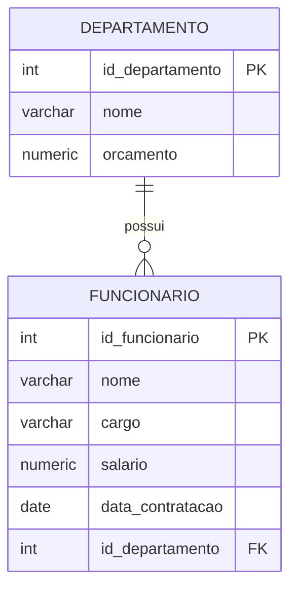

# Aula 2 — SQL-DML: filtrando dados com WHERE

Na aula anterior começamos a manipular dados com `INSERT`, `SELECT`, `UPDATE` e `DELETE`. Nesta aula vamos aprofundar o uso da cláusula `WHERE`, principalmente no comando `SELECT`, mas também nos comandos `UPDATE` e `DELETE`.

O objetivo é aprender a selecionar, alterar e remover somente os registros que atendem a uma condição.

Nesta aula estudaremos:

- a sintaxe básica do `SELECT`;
- filtros com `WHERE`;
- condições com `AND` e `OR`;
- testes de valores nulos com `IS NULL`;
- buscas textuais com `LIKE`;
- funções de strings;
- funções básicas para manipulação de datas;
- o uso das mesmas condições em `UPDATE` e `DELETE`.

## Alterando uma tabela do nosso banco de exemplo

Nos exemplos desta aula vamos usar basicamente o mesmo modelo simples de departamentos e funcionários da aula anterior. A única alteração será o acréscimo do campo `data_contratacao` à tabela `funcionario`.

Um `Departamento` pode possuir vários `Funcionarios`, mas cada funcionário pertence a um único departamento.



Se o banco de dados da aula anterior já foi criado, não é necessário criar as tabelas novamente. Basta executar o script abaixo para acrescentar a nova coluna à tabela `funcionario`:

```sql
ALTER TABLE funcionario
ADD COLUMN data_contratacao DATE;
```

Caso ainda não tenha criado o banco da aula anterior, volte à aula anterior, obtenha lá o script de criação do banco e execute-o antes de iniciar esta aula. Depois disso, execute o `ALTER TABLE` apresentado acima.

Os exemplos abaixo consideram que existem departamentos com identificadores 1 e 2 e funcionários com diferentes cargos, salários e datas de contratação.

## SELECT

O comando `SELECT` consulta registros. Sua sintaxe mais simples é:

```sql
SELECT coluna_1, coluna_2
FROM tabela;
```

Para consultar todas as colunas, podemos usar `*`:

```sql
SELECT *
FROM funcionario;
```

### Selecionando colunas específicas

Para exibir o nome, o cargo e o salário de todos os funcionários:

```sql
SELECT nome, cargo, salario
FROM funcionario;
```

O comando retorna somente as colunas listadas, mas considera todos os registros da tabela.

### Filtrando com WHERE

A cláusula `WHERE` define quais registros serão retornados:

```sql
SELECT coluna_1, coluna_2
FROM tabela
WHERE condição;
```

Para exibir nome, cargo e salário somente dos funcionários do departamento 1:

```sql
SELECT nome, cargo, salario
FROM funcionario
WHERE id_departamento = 1;
```

O operador `=` verifica igualdade. Também podemos utilizar operadores de comparação:

| Operador | Significado |
|---|---|
| `=` | igual a |
| `<>` ou `!=` | diferente de |
| `>` | maior que |
| `<` | menor que |
| `>=` | maior ou igual a |
| `<=` | menor ou igual a |

Por exemplo, para exibir os funcionários que não pertencem ao departamento 1, podemos usar o operador `<>`:

```sql
SELECT nome, cargo, salario
FROM funcionario
WHERE id_departamento <> 1;
```

## Condições lógicas com AND e OR

Uma condição do `WHERE` pode combinar vários testes lógicos.

O operador `AND` exige que todas as condições sejam verdadeiras. O exemplo abaixo mostra o nome, o cargo e o salário dos funcionários do departamento 1 que ganham mais de 1500:

```sql
SELECT nome, cargo, salario
FROM funcionario
WHERE id_departamento = 1
  AND salario > 1500;
```

Agora vamos trocar `AND` por `OR`:

```sql
SELECT nome, cargo, salario
FROM funcionario
WHERE id_departamento = 1
   OR salario > 1500;
```

Com `AND`, o funcionário precisa satisfazer as duas condições. Com `OR`, basta satisfazer pelo menos uma delas. Por isso, a consulta com `OR` normalmente retorna mais registros: ela inclui todos os funcionários do departamento 1, mesmo que ganhem até 1500, e funcionários de outros departamentos que ganhem mais de 1500.

Quando uma condição combina vários operadores, parênteses ajudam a deixar a intenção explícita. Por exemplo, a consulta abaixo retorna todos os funcionários do departamento 1 que sejam analistas ou tenham salario acima de 1500.

```sql
SELECT nome, cargo, salario
FROM funcionario
WHERE id_departamento = 1
  AND (cargo = 'Analista' OR salario > 5000);
```
Note que a troca da posição dos parênteses pode alterar o resultado! Faça testes.

## Valores nulos com IS NULL

Um campo que não recebeu valor armazena `NULL`. `NULL` não significa uma string vazia nem o número zero: significa ausência de valor conhecido.

Para inserir um funcionário sem cargo, basta não informar a coluna `cargo`:

```sql
INSERT INTO funcionario (nome, salario, id_departamento)
VALUES ('Fernanda Costa', 1800.00, 1);
```

Para localizar funcionários sem cargo, use `IS NULL`:

```sql
SELECT *
FROM funcionario
WHERE cargo IS NULL;
```

Para localizar funcionários que possuem cargo:

```sql
SELECT *
FROM funcionario
WHERE cargo IS NOT NULL;
```

Não devemos escrever `cargo = NULL`. Comparações comuns com `NULL` não produzem o resultado esperado; use sempre `IS NULL` ou `IS NOT NULL`.

## LIKE e pesquisas em strings

O operador `LIKE` compara textos usando padrões.

- `%` representa zero ou mais caracteres;
- `_` representa exatamente um caractere.

Para encontrar funcionários cujo nome começa com `A`:

```sql
SELECT nome, cargo
FROM funcionario
WHERE nome LIKE 'A%';
```

Para encontrar funcionários cujo nome contém `Silva` em qualquer posição:

```sql
SELECT nome, cargo
FROM funcionario
WHERE nome LIKE '%Silva%';
```

Para encontrar nomes que terminam com `a`:

```sql
SELECT nome
FROM funcionario
WHERE nome LIKE '%a';
```

O padrão abaixo procura nomes iniciados por `A` seguidos de exatamente quatro caracteres:

```sql
SELECT nome
FROM funcionario
WHERE nome LIKE 'A____';
```

Também podemos pesquisar nomes de departamentos:

```sql
SELECT nome
FROM departamento
WHERE nome LIKE 'Rec%';
```

No PostgreSQL, `LIKE` diferencia letras maiúsculas de minúsculas. Quando desejamos uma comparação sem diferenciar maiúsculas e minúsculas, podemos utilizar `ILIKE`:

```sql
SELECT nome
FROM funcionario
WHERE nome ILIKE '%silva%';
```

## Funções de strings

Funções de strings permitem medir, transformar e extrair partes de textos. Algumas funções bastante utilizadas são:

| Função | Finalidade |
|---|---|
| `LENGTH(texto)` | Retorna a quantidade de caracteres. |
| `UPPER(texto)` | Converte o texto para maiúsculas. |
| `LOWER(texto)` | Converte o texto para minúsculas. |
| `INITCAP(texto)` | Coloca a primeira letra de cada palavra em maiúscula. |
| `TRIM(texto)` | Remove espaços no início e no fim. |
| `LEFT(texto, quantidade)` | Retorna caracteres a partir da esquerda. |
| `RIGHT(texto, quantidade)` | Retorna caracteres a partir da direita. |
| `SUBSTRING(texto FROM início FOR quantidade)` | Extrai parte do texto. |
| `REPLACE(texto, antigo, novo)` | Substitui uma parte do texto. |
| `CONCAT(valor1, valor2, ...)` | Concatena valores. |

### Medindo o tamanho dos nomes

```sql
SELECT nome,
       LENGTH(nome) AS quantidade_caracteres
FROM funcionario;
```

Também podemos medir os nomes dos departamentos:

```sql
SELECT nome,
       LENGTH(nome) AS quantidade_caracteres
FROM departamento;
```

### Alterando a forma de exibição

```sql
SELECT nome,
       UPPER(nome) AS nome_maiusculo,
       LOWER(nome) AS nome_minusculo,
       INITCAP(nome) AS nome_formatado
FROM funcionario;
```

```sql
SELECT nome,
       UPPER(nome) AS departamento_maiusculo,
       LOWER(nome) AS departamento_minusculo
FROM departamento;
```

Essas funções alteram apenas a forma de exibição do resultado. Elas não alteram o valor armazenado na tabela.

### Extraindo partes e substituindo textos

```sql
SELECT nome,
       LEFT(nome, 3) AS tres_primeiros_caracteres,
       RIGHT(nome, 3) AS tres_ultimos_caracteres,
       SUBSTRING(nome FROM 1 FOR 5) AS trecho_inicial
FROM funcionario;
```

```sql
SELECT nome,
       REPLACE(nome, 'a', '@') AS nome_com_substituicao
FROM departamento;
```

Também podemos concatenar textos na saída:

```sql
SELECT CONCAT(nome, ' — ', cargo) AS identificacao_funcionario
FROM funcionario
WHERE cargo IS NOT NULL;
```

## Manipulação básica de datas

O modelo desta aula possui a coluna `data_contratacao` na tabela `funcionario`. Além de consultar essa coluna, o PostgreSQL permite consultar a data atual e realizar operações com datas e intervalos.

Antes de executar os exemplos desta seção, vamos inserir alguns funcionários com datas de contratação diferentes. Execute este script uma única vez:

```sql
INSERT INTO funcionario
    (nome, cargo, salario, id_departamento, data_contratacao)
VALUES
    ('Mariana Alves', 'Analista', 3200.00, 1, DATE '2026-02-10'),
    ('Rafael Souza', 'Assistente', 1800.00, 2, DATE '2022-06-15'),
    ('Patrícia Lima', 'Gerente', 5200.00, 1, DATE '2018-09-03');
```

Para demonstrar o preenchimento de uma data nula, também podemos inserir um funcionário sem informar a data de contratação:

```sql
INSERT INTO funcionario
    (nome, cargo, salario, id_departamento)
VALUES
    ('Lucas Mendes', 'Estagiário', 1200.00, 2);
```

### Data e horário atuais

```sql
SELECT CURRENT_DATE AS data_atual,
       CURRENT_TIMESTAMP AS data_e_hora_atual;
```

### Operações com datas

```sql
SELECT CURRENT_DATE AS hoje,
       CURRENT_DATE + INTERVAL '7 days' AS daqui_a_uma_semana,
       CURRENT_DATE - INTERVAL '30 days' AS trinta_dias_atras;
```

Para obter os funcionários contratados há mais de três anos, podemos comparar a data de contratação com a data de hoje menos três anos:

```sql
SELECT nome, data_contratacao
FROM funcionario
WHERE data_contratacao < CURRENT_DATE - INTERVAL '3 years';
```

Também podemos usar `CURRENT_DATE` para preencher a data de contratação dos funcionários que ainda estão sem essa informação:

```sql
UPDATE funcionario
SET data_contratacao = CURRENT_DATE
WHERE data_contratacao IS NULL;
```

O `WHERE` garante que a data dos funcionários que já possuem uma contratação registrada não será alterada.

### Consultando funcionários por data de contratação

Também podemos ordenar os funcionários pela data de contratação, dos mais antigos para os mais recentes:

```sql
SELECT nome, data_contratacao
FROM funcionario
WHERE data_contratacao IS NOT NULL
ORDER BY data_contratacao;
```

### Extraindo partes de uma data

Para obter os funcionários contratados em 2026, podemos extrair o ano da data de contratação e compará-lo com `2026`:

```sql
SELECT nome, data_contratacao
FROM funcionario
WHERE EXTRACT(YEAR FROM data_contratacao) = 2026;
```

Também podemos extrair outras partes da data, como o mês e o dia:

```sql
SELECT nome,
       EXTRACT(YEAR FROM data_contratacao) AS ano,
       EXTRACT(MONTH FROM data_contratacao) AS mes,
       EXTRACT(DAY FROM data_contratacao) AS dia
FROM funcionario
WHERE data_contratacao IS NOT NULL;
```

### Formatando uma data

```sql
SELECT nome,
       TO_CHAR(data_contratacao, 'DD/MM/YYYY') AS data_formatada
FROM funcionario
WHERE data_contratacao IS NOT NULL;
```

As mesmas expressões podem ser usadas em `SELECT`, `WHERE`, `UPDATE` e `DELETE` para consultar e manipular a coluna `data_contratacao`.

## WHERE em UPDATE e DELETE

A cláusula `WHERE` não é exclusiva do `SELECT`. Ela também define quais registros serão alterados pelo `UPDATE` e removidos pelo `DELETE`.

### UPDATE de funcionários sem cargo

Primeiro, podemos conferir os registros que serão alterados:

```sql
SELECT *
FROM funcionario
WHERE cargo IS NULL;
```

Depois, podemos preencher o cargo desses funcionários:

```sql
UPDATE funcionario
SET cargo = 'A definir'
WHERE cargo IS NULL;
```

O `WHERE` impede que o novo cargo seja aplicado a todos os funcionários.

### DELETE com AND

O comando abaixo removeria somente os funcionários do departamento 1 que ganham menos de 1500:

```sql
DELETE FROM funcionario
WHERE id_departamento = 1
  AND salario < 1500;
```

Antes de executar um `DELETE`, é recomendável usar a mesma condição em um `SELECT`:

```sql
SELECT *
FROM funcionario
WHERE id_departamento = 1
  AND salario < 1500;
```

### UPDATE com LIKE

Podemos usar `LIKE` no `WHERE` e uma função de string no `SET`. O exemplo abaixo transforma em maiúscula a primeira letra dos nomes que começam com `a` minúsculo:

```sql
UPDATE funcionario
SET nome = UPPER(LEFT(nome, 1)) || SUBSTRING(nome FROM 2)
WHERE nome LIKE 'a%';
```

O operador `||` concatena os textos. `LEFT(nome, 1)` obtém a primeira letra e `SUBSTRING(nome FROM 2)` preserva o restante do nome.

### Atenção ao WHERE

Sem `WHERE`, o comando altera ou remove todos os registros:

```sql
-- Não execute sem ter certeza:
UPDATE funcionario
SET cargo = 'A definir';
```

```sql
-- Não execute sem ter certeza:
DELETE FROM funcionario;
```

Por isso, uma boa prática é executar primeiro um `SELECT` com a mesma condição e conferir os registros que serão afetados.

## Resumo da aula

| Recurso | Finalidade |
|---|---|
| `WHERE` | Filtra registros em consultas, alterações e exclusões. |
| `AND` | Exige que todas as condições sejam verdadeiras. |
| `OR` | Aceita registros que satisfaçam pelo menos uma condição. |
| `IS NULL` | Localiza ausência de valor. |
| `LIKE` | Pesquisa textos usando padrões. |
| `%` | Representa zero ou mais caracteres em um padrão. |
| `_` | Representa exatamente um caractere em um padrão. |
| Funções de string | Medem, transformam e extraem textos. |
| Funções de data | Consultam, calculam e formatam datas. |

## Atividade

Para praticar os conteúdos desta aula, realize a [Atividade 2 — SQL](aula2_sql_atividades.md).
