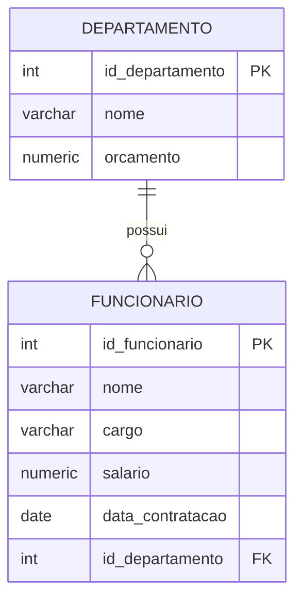

# Aula 4 — Consultando dados de várias tabelas

Nas aulas anteriores, aprendemos a consultar e alterar dados de uma tabela usando `SELECT`, `WHERE`, `UPDATE` e `DELETE`. Agora vamos tratar de uma situação muito comum: a informação de que precisamos está distribuída em tabelas diferentes.

Imagine que desejamos produzir uma listagem com o nome de cada funcionário e o nome do departamento ao qual ele pertence. O nome do funcionário está na tabela `funcionario`, enquanto o nome do departamento está na tabela `departamento`. Para produzir essa listagem, precisamos combinar os registros relacionados das duas tabelas.

O objetivo principal desta aula é compreender o conceito de junção e utilizar `INNER JOIN` para consultar dados relacionados. No final, veremos também como uma junção pode ser usada em comandos `UPDATE` e `DELETE`.

Nesta aula estudaremos:

- a necessidade de combinar informações de tabelas diferentes;
- o conceito de produto cartesiano;
- a relação entre chave primária e chave estrangeira em uma junção;
- a sintaxe do `INNER JOIN`;
- junções envolvendo mais de duas tabelas;
- o uso de junções em `UPDATE` e `DELETE`.

## Modelo usado nos exemplos

Continuaremos usando basicamente o mesmo modelo simples de departamentos e funcionários das aulas anteriores. A tabela `funcionario` possui uma chave estrangeira que indica o departamento de cada funcionário. Ela também possui a coluna `data_contratacao`, acrescentada na aula 2.



Utilize o banco de dados preparado nas aulas anteriores. Caso ainda não tenha criado as tabelas, consulte o script de criação da aula 1 e execute também o `ALTER TABLE` apresentado na aula 2 para acrescentar `data_contratacao`.

Os exemplos consideram que existem departamentos e funcionários cadastrados e que cada funcionário possui um valor de `id_departamento` correspondente a um departamento existente.

## A necessidade de combinar tabelas

Uma consulta simples à tabela `funcionario` permite obter os funcionários, mas não permite exibir o nome do departamento, pois essa informação está em outra tabela:

```sql
SELECT nome, cargo, salario, id_departamento
FROM funcionario;
```

O campo `id_departamento` identifica o departamento, mas não é tão informativo quanto seu nome. Para obter os nomes dos funcionários e de seus respectivos departamentos, precisamos relacionar as tabelas `funcionario` e `departamento` por meio dos campos que representam essa relação.

## Produto cartesiano

Antes de apresentar o `INNER JOIN`, vamos observar o que acontece quando colocamos duas tabelas na cláusula `FROM` sem informar como seus registros devem ser relacionados.

```sql
SELECT d.id_departamento,
       d.nome AS nome_departamento,
       f.id_funcionario,
       f.nome AS nome_funcionario,
       f.id_departamento
FROM departamento AS d,
     funcionario AS f;
```

Nesse caso, o banco produz um produto cartesiano: cada linha de `departamento` é combinada com cada linha de `funcionario`. Se existirem 2 departamentos e 4 funcionários, o resultado terá 8 combinações.

Entre essas combinações aparecerão, por exemplo, um funcionário do departamento 1 associado ao nome do departamento 2 e um funcionário do departamento 2 associado ao nome do departamento 1. Essas combinações não representam a realidade do nosso banco e, portanto, o resultado não faz sentido para a listagem desejada.

Para que a consulta faça sentido, precisamos combinar a chave primária de `departamento` com a chave estrangeira correspondente em `funcionario`:

```text
departamento.id_departamento = funcionario.id_departamento
```

Essa é a condição que identifica quais linhas das duas tabelas representam uma relação verdadeira.

## Usando INNER JOIN

O `INNER JOIN` permite declarar explicitamente a relação entre as tabelas. Sua sintaxe básica é:

```sql
SELECT colunas
FROM tabela_principal AS a
INNER JOIN tabela_relacionada AS b
    ON a.chave = b.chave_estrangeira;
```

A condição da junção é escrita depois de `ON`. No nosso modelo, podemos relacionar a chave primária de `departamento` com a chave estrangeira de `funcionario`:

```sql
SELECT f.id_funcionario,
       f.nome AS nome_funcionario,
       d.id_departamento,
       d.nome AS nome_departamento
FROM funcionario AS f
INNER JOIN departamento AS d
    ON d.id_departamento = f.id_departamento;
```

Agora cada funcionário aparece associado ao nome do departamento indicado em seu `id_departamento`. Em vez de todas as combinações possíveis, o resultado apresenta somente as linhas que possuem correspondência entre as chaves.

Uma junção pode ser combinada com um filtro `WHERE`. Por exemplo, para listar somente os funcionários do departamento chamado `Tecnologia`:

```sql
SELECT f.nome AS nome_funcionario,
       f.cargo,
       d.nome AS nome_departamento
FROM funcionario AS f
INNER JOIN departamento AS d
    ON d.id_departamento = f.id_departamento
WHERE d.nome = 'Tecnologia';
```

### A mesma consulta usando WHERE

O mesmo resultado poderia ser obtido usando a forma antiga, colocando as duas tabelas no `FROM` e a condição das chaves no `WHERE`:

```sql
SELECT f.id_funcionario,
       f.nome AS nome_funcionario,
       d.id_departamento,
       d.nome AS nome_departamento
FROM funcionario AS f,
     departamento AS d
WHERE d.id_departamento = f.id_departamento;
```

Embora as duas consultas produzam o mesmo resultado quando a condição está correta, o `INNER JOIN` torna mais clara a intenção do comando. A cláusula `ON` informa como as tabelas se relacionam, enquanto a cláusula `WHERE` fica disponível para os filtros da consulta. Essa separação facilita a leitura, a manutenção e a identificação de erros que poderiam produzir um produto cartesiano.

### Junções de mais de duas tabelas

Podemos combinar mais de duas tabelas na mesma consulta. Para isso, adicionamos outro `INNER JOIN` e informamos a condição que relaciona a nova tabela às tabelas já presentes:

```sql
SELECT colunas
FROM tabela_a AS a
INNER JOIN tabela_b AS b
    ON b.chave = a.chave_b
INNER JOIN tabela_c AS c
    ON c.chave = b.chave_c;
```

Na lista de exercícios desta aula haverá consultas que combinam três ou mais tabelas. Nesses casos, é importante identificar as chaves que conectam cada tabela e escrever uma condição de junção para cada nova tabela acrescentada.

## INNER JOIN com UPDATE e DELETE

As junções também podem ajudar a localizar os registros que serão alterados ou excluídos. Antes de executar esses comandos, é importante fazer uma consulta de conferência usando as mesmas condições.

### UPDATE usando uma tabela relacionada

Suponha que desejamos conceder um reajuste de 10% aos funcionários que pertencem a departamentos com orçamento superior a um milhão. Primeiro, podemos conferir os funcionários que serão afetados:

```sql
SELECT f.nome AS nome_funcionario,
       f.salario,
       d.nome AS nome_departamento,
       d.orcamento
FROM funcionario AS f
INNER JOIN departamento AS d
    ON d.id_departamento = f.id_departamento
WHERE d.orcamento > 1000000;
```

No PostgreSQL, uma tabela relacionada pode ser usada no `UPDATE` por meio da cláusula `FROM`:

```sql
UPDATE funcionario AS f
SET salario = f.salario * 1.10
FROM departamento AS d
WHERE d.id_departamento = f.id_departamento
  AND d.orcamento > 1000000;
```

A condição que relaciona as tabelas aparece no `WHERE`, junto com a condição do orçamento. Somente os funcionários cujo departamento atende ao filtro receberão o reajuste.

### DELETE usando uma tabela relacionada

Agora suponha que desejamos excluir todos os funcionários pertencentes a departamentos com orçamento menor que mil. Primeiro, podemos consultar os registros:

```sql
SELECT f.id_funcionario,
       f.nome AS nome_funcionario,
       d.nome AS nome_departamento,
       d.orcamento
FROM funcionario AS f
INNER JOIN departamento AS d
    ON d.id_departamento = f.id_departamento
WHERE d.orcamento < 1000;
```

No PostgreSQL, uma tabela relacionada pode ser informada no `DELETE` por meio da cláusula `USING`:

```sql
DELETE FROM funcionario AS f
USING departamento AS d
WHERE d.id_departamento = f.id_departamento
  AND d.orcamento < 1000;
```

Nesse comando, a condição das chaves garante que somente os funcionários dos departamentos correspondentes sejam excluídos. O filtro do orçamento limita a operação aos departamentos com orçamento menor que mil.

## Resumo

O `INNER JOIN` permite consultar somente os registros que possuem correspondência entre tabelas relacionadas. A condição normalmente compara a chave primária de uma tabela com a chave estrangeira de outra.

Em uma consulta com junções:

- use `ON` para informar como as tabelas se relacionam;
- use `WHERE` para aplicar filtros aos registros relacionados;
- utilize aliases para deixar os comandos mais curtos e claros;
- acrescente um novo `INNER JOIN` para cada tabela adicional;
- confira os registros antes de executar `UPDATE` ou `DELETE`.

Na atividade da aula 4, o mesmo banco `Loja` das atividades anteriores será usado para praticar consultas com duas, três e mais tabelas.
