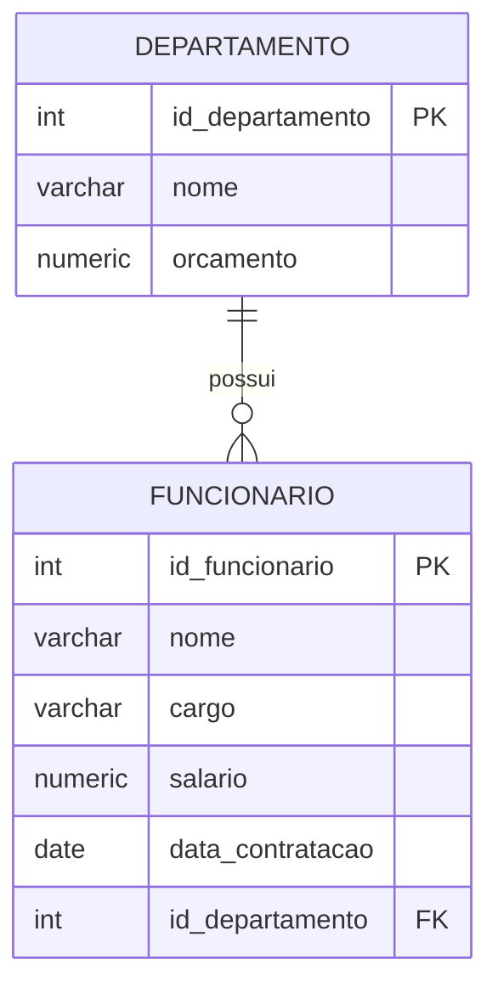

# Aula 5 — Funções de agregação, GROUP BY e HAVING

Nas aulas anteriores, aprendemos a consultar dados de uma tabela e a combinar informações relacionadas usando `INNER JOIN`. Nesta aula, vamos aprender a resumir vários registros em resultados como contagens, médias, valores mínimos e máximos e totais.

O objetivo principal é compreender as funções de agregação e como agrupamos os registros para obter resultados separados por departamento. Também veremos como filtrar os grupos resultantes usando `HAVING`.

Nesta aula estudaremos:

- as funções `COUNT`, `MIN`, `MAX`, `AVG` e `SUM`;
- a necessidade da cláusula `GROUP BY`;
- a diferença entre `WHERE` e `HAVING`;
- consultas de resumo usando as tabelas `departamento` e `funcionario`.

## Modelo usado nos exemplos

Continuaremos usando o banco de dados das aulas anteriores. A tabela `funcionario` possui uma chave estrangeira que indica o departamento ao qual cada funcionário pertence.



Utilize os dados cadastrados nas aulas anteriores. As consultas que exibem o nome do departamento combinam as tabelas por meio de `INNER JOIN`, como vimos na aula 4.

## Quantidade de funcionários por departamento

Imagine que queremos produzir um relatório com o nome de cada departamento e a quantidade de funcionários que nele trabalham. Para contar registros, usamos a função de agregação `COUNT`.

```sql
SELECT d.nome AS nome_departamento,
       COUNT(f.id_funcionario) AS quantidade_funcionarios
FROM departamento AS d
INNER JOIN funcionario AS f
    ON f.id_departamento = d.id_departamento
GROUP BY d.nome;
```

O resultado apresenta o nome do departamento e a quantidade de funcionários agrupados por esse nome.

### Por que precisamos de GROUP BY?

Sem `GROUP BY`, uma função como `COUNT` resume todas as linhas consideradas pela consulta em um único resultado. Quando queremos um resumo separado para cada departamento, precisamos informar ao banco quais linhas formam cada grupo.

A cláusula `GROUP BY` faz essa divisão. No primeiro exemplo, os registros são agrupados pelo nome do departamento. Em seguida, `COUNT` é calculado separadamente para cada grupo.

Quando usamos uma função de agregação junto com outras colunas no `SELECT`, as colunas que não estão dentro de uma função de agregação precisam aparecer no `GROUP BY`. No exemplo, `d.nome` aparece no `SELECT` e também no agrupamento.

Mas há um detalhe importante: nosso banco não define o nome do departamento como único. Portanto, dois departamentos diferentes podem ter o mesmo nome. Se isso acontecer, o agrupamento somente por nome reunirá os funcionários dos dois departamentos em um único grupo e exibirá uma única contagem para aquele nome.

Para manter cada departamento em seu próprio grupo, também podemos incluir o identificador no `GROUP BY`:

```sql
SELECT d.nome AS nome_departamento,
       COUNT(f.id_funcionario) AS quantidade_funcionarios
FROM departamento AS d
INNER JOIN funcionario AS f
    ON f.id_departamento = d.id_departamento
GROUP BY d.id_departamento, d.nome;
```

O identificador não precisa aparecer no `SELECT` para participar do agrupamento. Se dois departamentos tiverem o mesmo nome, essa consulta exibirá duas linhas com esse nome; cada linha terá a contagem do departamento identificado por seu próprio `id_departamento`.

Para observar essa diferença na prática, insira um novo departamento com o mesmo nome de um departamento já existente. Consulte o `id_departamento` gerado para o novo departamento e insira um funcionário vinculado a esse departamento. Em seguida, execute novamente as duas consultas desta seção — a que agrupa somente pelo nome e a que agrupa pelo nome e pelo identificador — e compare os resultados.

## Filtrando grupos com HAVING

A cláusula `WHERE` filtra as linhas antes da formação dos grupos. Já `HAVING` filtra os grupos depois que eles são formados e as funções de agregação são calculadas.

Por exemplo, para retornar apenas os departamentos que possuem mais de três funcionários:

```sql
SELECT d.nome AS nome_departamento,
       COUNT(f.id_funcionario) AS quantidade_funcionarios
FROM departamento AS d
INNER JOIN funcionario AS f
    ON f.id_departamento = d.id_departamento
GROUP BY d.id_departamento, d.nome
HAVING COUNT(f.id_funcionario) > 3;
```

Nesse caso, `HAVING` consegue testar a quantidade calculada para cada departamento. Não poderíamos usar `WHERE COUNT(...) > 3`, pois `WHERE` é aplicado antes de a contagem dos grupos existir.

| Cláusula | O que filtra | Momento em que atua |
|---|---|---|
| `WHERE` | Linhas individuais | Antes do agrupamento |
| `HAVING` | Grupos e resultados agregados | Depois do agrupamento |

Podemos usar `WHERE` e `HAVING` na mesma consulta: primeiro o `WHERE` restringe as linhas que participarão da consulta; depois o `GROUP BY` forma os grupos; por fim, `HAVING` seleciona quais grupos serão exibidos.

### Usando WHERE e HAVING na mesma consulta

Para listar os departamentos com orçamento maior que 10 mil e menos de 10 funcionários, usamos `WHERE` para selecionar os departamentos pelo orçamento e `HAVING` para filtrar os grupos pela quantidade de funcionários:

```sql
SELECT d.nome AS nome_departamento,
       COUNT(f.id_funcionario) AS quantidade_funcionarios
FROM departamento AS d
INNER JOIN funcionario AS f
    ON f.id_departamento = d.id_departamento
WHERE d.orcamento > 10000
GROUP BY d.id_departamento, d.nome
HAVING COUNT(f.id_funcionario) < 10;
```

## Outras funções de agregação

Além de `COUNT`, há outras funções que ajudam a produzir resumos:

| Função | Resultado |
|---|---|
| `MIN(coluna)` | Menor valor da coluna no grupo |
| `MAX(coluna)` | Maior valor da coluna no grupo |
| `AVG(coluna)` | Média dos valores da coluna no grupo |
| `SUM(coluna)` | Soma dos valores da coluna no grupo |

Podemos combinar essas funções para obter um resumo dos salários de cada departamento:

```sql
SELECT d.nome AS nome_departamento,
       COUNT(f.id_funcionario) AS quantidade_funcionarios,
       AVG(f.salario) AS salario_medio,
       MIN(f.salario) AS menor_salario,
       MAX(f.salario) AS maior_salario,
       SUM(f.salario) AS total_salarios
FROM departamento AS d
INNER JOIN funcionario AS f
    ON f.id_departamento = d.id_departamento
GROUP BY d.id_departamento, d.nome;
```

Para cada departamento, essa consulta apresenta:

- `COUNT`: quantos funcionários estão no grupo;
- `AVG`: o salário médio;
- `MIN`: o menor salário;
- `MAX`: o maior salário;
- `SUM`: a soma dos salários, que pode ser interpretada como o total da folha salarial do grupo.

As funções `MIN`, `MAX`, `AVG` e `SUM` são aplicadas aos valores de salário de cada departamento porque a consulta possui o agrupamento por departamento. Se retirássemos o `GROUP BY`, cada função resumiria os salários de todos os funcionários retornados pela consulta em um único resultado.

### Valores nulos

As funções `MIN`, `MAX`, `AVG` e `SUM` ignoram valores `NULL`. `COUNT(coluna)` também conta somente os valores não nulos daquela coluna. Já `COUNT(*)` conta as linhas do resultado, independentemente de haver colunas nulas.

Como `id_funcionario` é uma chave primária e não pode ser nula, `COUNT(f.id_funcionario)` conta os funcionários relacionados em cada grupo.

Também podemos comparar `COUNT(*)` com `COUNT(cargo)`:

```sql
SELECT COUNT(*) AS total_funcionarios,
       COUNT(cargo) AS funcionarios_com_cargo
FROM funcionario;
```

`COUNT(*)` conta todas as linhas da tabela. Já `COUNT(cargo)` conta somente os funcionários cujo campo `cargo` não é `NULL`. Portanto, se houver funcionários sem cargo, o primeiro resultado será maior. Por exemplo, se houver 5 funcionários e um deles estiver sem cargo, a consulta retornará `5` em `total_funcionarios` e `4` em `funcionarios_com_cargo`.

## Resumo da aula

- Funções de agregação resumem várias linhas em um valor, como uma contagem, média, mínimo, máximo ou soma.
- `GROUP BY` separa as linhas em grupos para que a agregação seja calculada para cada grupo.
- Colunas exibidas no `SELECT` que não estão dentro de funções de agregação devem ser incluídas no `GROUP BY`.
- `WHERE` filtra linhas antes do agrupamento; `HAVING` filtra grupos depois da agregação.
- `COUNT`, `MIN`, `MAX`, `AVG` e `SUM` podem ser combinadas em uma mesma consulta.
