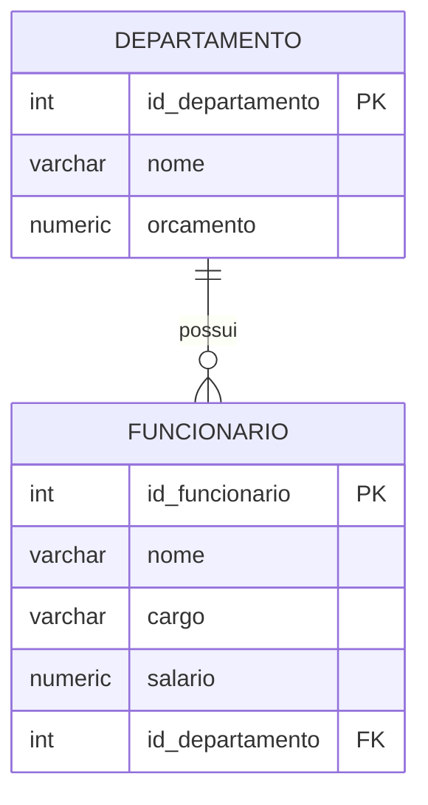

# Aula 7 — OUTER JOIN

Nesta aula, vamos aprofundar o uso de junções entre tabelas. Na aula 4, usamos `INNER JOIN` para combinar departamentos e funcionários que possuíam relacionamento entre si. Agora veremos como também exibir registros que não possuem correspondência na outra tabela.

O objetivo é compreender o `LEFT JOIN`, uma forma de `OUTER JOIN` muito útil, por exemplo, para identificar departamentos que ainda não têm funcionários.

## Modelo usado nos exemplos

Continuaremos usando o banco das aulas anteriores. Cada funcionário está associado a um departamento por meio de `funcionario.id_departamento`, que referencia `departamento.id_departamento`.



Para que possamos observar claramente a diferença entre `INNER JOIN` e `LEFT JOIN`, crie um novo departamento sem cadastrar funcionários nele:

```sql
INSERT INTO departamento (nome, orcamento)
VALUES ('Pesquisa e Desenvolvimento', 180000.00);
```

O departamento inserido ficará sem funcionários associados. Ele será usado nos próximos exemplos.

## Relembrando o INNER JOIN

O `INNER JOIN` retorna somente as linhas que possuem correspondência nas duas tabelas. Portanto, nesta consulta, somente aparecem departamentos que possuem pelo menos um funcionário:

```sql
SELECT d.nome AS nome_departamento,
       f.nome AS nome_funcionario
FROM departamento AS d
INNER JOIN funcionario AS f
    ON f.id_departamento = d.id_departamento;
```

Como o departamento `Pesquisa e Desenvolvimento` não possui funcionários, ele não aparece no resultado.

## Usando LEFT JOIN

O `LEFT JOIN` mantém todas as linhas da tabela que aparece à esquerda da junção, mesmo quando não existe uma linha correspondente na tabela à direita. Por isso, ele também é chamado de `LEFT OUTER JOIN`.

```sql
SELECT d.nome AS nome_departamento,
       f.nome AS nome_funcionario
FROM departamento AS d
LEFT JOIN funcionario AS f
    ON f.id_departamento = d.id_departamento;
```

Agora todos os departamentos aparecem. Nos departamentos que possuem funcionários, cada funcionário é exibido em uma linha. Para o departamento sem funcionários, o nome do departamento aparece normalmente e `nome_funcionario` recebe o valor `NULL`, pois não há uma linha correspondente em `funcionario`.

`LEFT JOIN` e `LEFT OUTER JOIN` possuem exatamente o mesmo resultado. A palavra `OUTER` é opcional:

```sql
SELECT d.nome AS nome_departamento,
       f.nome AS nome_funcionario
FROM departamento AS d
LEFT OUTER JOIN funcionario AS f
    ON f.id_departamento = d.id_departamento;
```

Na prática, é comum escrever apenas `LEFT JOIN`.

## Contando funcionários, inclusive nos departamentos vazios

Na aula 5, contamos os funcionários de cada departamento com `INNER JOIN`. Podemos adaptar essa consulta para que departamentos sem funcionários também sejam exibidos:

```sql
SELECT d.nome AS nome_departamento,
       COUNT(f.id_funcionario) AS quantidade_funcionarios
FROM departamento AS d
LEFT JOIN funcionario AS f
    ON f.id_departamento = d.id_departamento
GROUP BY d.id_departamento, d.nome
ORDER BY d.nome;
```

O departamento `Pesquisa e Desenvolvimento` aparecerá com `0` em `quantidade_funcionarios`.

É importante contar `f.id_funcionario`, e não usar `COUNT(*)`. Com o `LEFT JOIN`, mesmo um departamento sem funcionários gera uma linha no resultado da junção: os campos de `funcionario` ficam `NULL`. Assim, `COUNT(*)` contaria essa linha e retornaria `1`, o que seria incorreto. Já `COUNT(f.id_funcionario)` ignora valores `NULL` e retorna `0` quando não há funcionário relacionado.

## Resumo de salários por departamento

Também podemos adaptar a consulta de agregações da aula 5. Além de contar funcionários, ela apresenta o menor, o maior, a média e a soma dos salários em cada departamento:

```sql
SELECT d.nome AS nome_departamento,
       COUNT(f.id_funcionario) AS quantidade_funcionarios,
       MIN(f.salario) AS menor_salario,
       MAX(f.salario) AS maior_salario,
       AVG(f.salario) AS media_salarial,
       SUM(f.salario) AS total_salarios
FROM departamento AS d
LEFT JOIN funcionario AS f
    ON f.id_departamento = d.id_departamento
GROUP BY d.id_departamento, d.nome
ORDER BY d.nome;
```

Para departamentos sem funcionários, a quantidade será `0`. As demais funções retornam `NULL`, porque não existe salário a ser calculado. Esse resultado indica corretamente que o departamento está cadastrado, mas ainda não possui funcionários.

## Combinando WHERE, HAVING e LEFT JOIN

Podemos usar `WHERE` e `HAVING` com `LEFT JOIN`, assim como fizemos na aula 5. A consulta a seguir retorna os departamentos com orçamento maior que 10 mil e menos de 10 funcionários, incluindo aqueles que não têm nenhum funcionário:

```sql
SELECT d.nome AS nome_departamento,
       d.orcamento,
       COUNT(f.id_funcionario) AS quantidade_funcionarios
FROM departamento AS d
LEFT JOIN funcionario AS f
    ON f.id_departamento = d.id_departamento
WHERE d.orcamento > 10000
GROUP BY d.id_departamento, d.nome, d.orcamento
HAVING COUNT(f.id_funcionario) < 10
ORDER BY d.nome;
```

O `WHERE` continua filtrando as linhas antes do agrupamento, neste caso pelo orçamento do departamento. O `HAVING` filtra os grupos depois de a quantidade de funcionários ter sido calculada. Como a contagem do departamento vazio é `0`, ele atende à condição `COUNT(f.id_funcionario) < 10`.

## Exibindo somente departamentos sem funcionários

Também podemos usar `LEFT JOIN` para encontrar os registros que não possuem correspondência. A partir da consulta de departamentos e funcionários da aula 4, basta selecionar as linhas em que a chave do funcionário ficou `NULL`:

```sql
SELECT d.id_departamento,
       d.nome AS nome_departamento,
       d.orcamento
FROM departamento AS d
LEFT JOIN funcionario AS f
    ON f.id_departamento = d.id_departamento
WHERE f.id_funcionario IS NULL
ORDER BY d.nome;
```

O `WHERE f.id_funcionario IS NULL` é aplicado depois do `LEFT JOIN` ter produzido as linhas sem correspondência. Por isso, a consulta retorna somente os departamentos que não possuem funcionários.

Tenha cuidado para não usar, por exemplo, `WHERE f.salario > 2000` em uma consulta cujo objetivo seja manter os departamentos sem funcionários. Como o salário desses departamentos é `NULL`, essa condição os eliminaria do resultado e o efeito seria semelhante ao de uma junção interna para esse filtro.

## Quando usar LEFT JOIN

Use `LEFT JOIN` quando a tabela à esquerda contém os registros que você deseja preservar no resultado, mesmo que não haja relação com a tabela à direita. Alguns exemplos são:

- listar todos os departamentos, inclusive os que ainda não possuem funcionários;
- contar funcionários por departamento, mostrando zero para departamentos vazios;
- identificar departamentos que não possuem funcionários;
- listar todos os clientes, mesmo aqueles que ainda não realizaram uma venda.

Também existe o `RIGHT JOIN` (ou `RIGHT OUTER JOIN`). Ele funciona de forma semelhante, mas preserva todos os registros da tabela que está à direita da junção. Por exemplo, esta consulta mantém todos os departamentos, pois `departamento` está à direita:

```sql
SELECT d.nome AS nome_departamento,
       f.nome AS nome_funcionario
FROM funcionario AS f
RIGHT JOIN departamento AS d
    ON d.id_departamento = f.id_departamento;
```

O resultado é o mesmo da consulta com `departamento` à esquerda e `LEFT JOIN`:

```sql
SELECT d.nome AS nome_departamento,
       f.nome AS nome_funcionario
FROM departamento AS d
LEFT JOIN funcionario AS f
    ON f.id_departamento = d.id_departamento;
```

Em geral, preferimos escrever a segunda forma: ela deixa mais claro que os departamentos são os registros que desejamos preservar. Assim, embora `RIGHT JOIN` seja útil para compreender a regra da junção externa, normalmente podemos substituí-lo por um `LEFT JOIN` trocando a ordem das tabelas.

## Resumo da aula

- `INNER JOIN` retorna somente os registros com correspondência entre as tabelas.
- `LEFT JOIN` preserva todos os registros da tabela à esquerda.
- `RIGHT JOIN` preserva todos os registros da tabela à direita e pode ser reescrito como `LEFT JOIN` ao inverter a ordem das tabelas.
- Nas colunas da tabela à direita, registros sem correspondência aparecem como `NULL`.
- Para contar registros relacionados em um `LEFT JOIN`, use `COUNT(coluna_da_tabela_direita)` em vez de `COUNT(*)`.
- A condição `WHERE coluna_da_tabela_direita IS NULL` permite identificar registros que não possuem correspondência.
