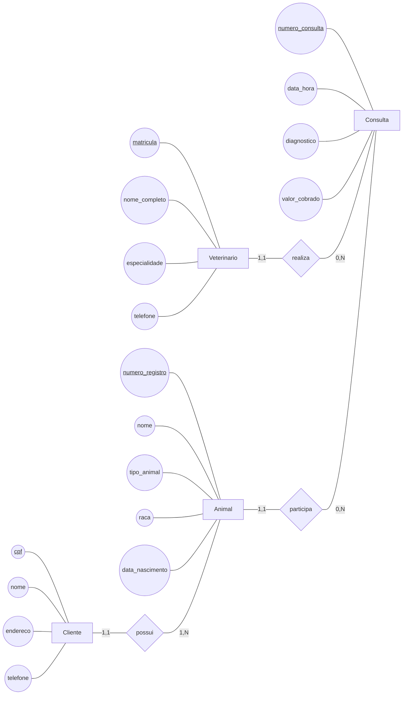
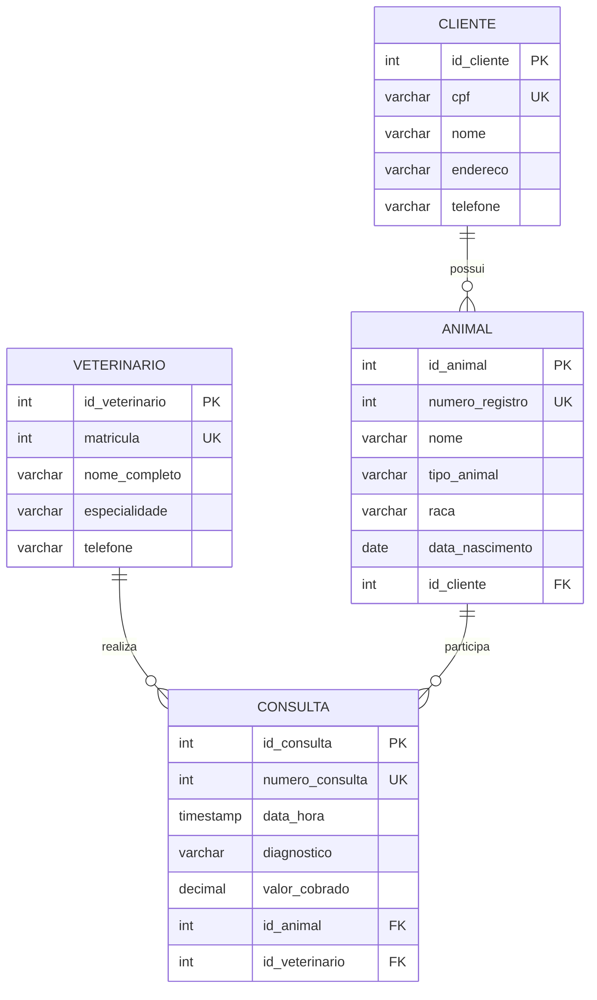

# Respostas da Dinâmica 1

## 1. Modelo conceitual — atividadeMER1

O cenário da clínica veterinária possui quatro entidades: `Veterinario`, `Cliente`, `Animal` e `Consulta`. 

### Diagrama conceitual



### Entidades, atributos e tipos conceituais

| Entidade | Atributo | Tipo | Identificador do domínio |
|---|---|---|:---:|
| Veterinario | matricula | INTEGER | Sim |
| Veterinario | nome_completo | VARCHAR(120) | Não |
| Veterinario | especialidade | VARCHAR(80) | Não |
| Veterinario | telefone | VARCHAR(20) | Não |
| Cliente | cpf | VARCHAR(11) | Sim |
| Cliente | nome | VARCHAR(120) | Não |
| Cliente | endereco | VARCHAR(200) | Não |
| Cliente | telefone | VARCHAR(20) | Não |
| Animal | numero_registro | INTEGER | Sim |
| Animal | nome | VARCHAR(80) | Não |
| Animal | tipo_animal | VARCHAR(40) | Não |
| Animal | raca | VARCHAR(80) | Não |
| Animal | data_nascimento | DATE | Não |
| Consulta | numero_consulta | INTEGER | Sim |
| Consulta | data_hora | TIMESTAMP | Não |
| Consulta | diagnostico | VARCHAR(500) | Não |
| Consulta | valor_cobrado | DECIMAL(10,2) | Não |

### Relacionamentos e cardinalidades

| Relacionamento | Cardinalidade | Interpretação |
|---|---|---|
| `Veterinario realiza Consulta` | Veterinario `(1,1)` — Consulta `(0,N)` | Um veterinário pode realizar várias consultas; cada consulta possui exatamente um veterinário responsável. |
| `Cliente possui Animal` | Cliente `(1,1)` — Animal `(1,N)` | Um cliente pode possuir vários animais; cada animal pertence a exatamente um cliente. |
| `Animal participa Consulta` | Animal `(1,1)` — Consulta `(0,N)` | Um animal pode participar de várias consultas; cada consulta envolve exatamente um animal. |

Todos os relacionamentos são 1:N: um lado possui cardinalidade máxima 1 e o outro possui cardinalidade máxima N.

### Análise conceitual da atividade

1. **Distribuição das cardinalidades máximas:** os três relacionamentos possuem máximo 1 do lado de `Consulta` ou `Animal`/`Cliente`, conforme o relacionamento, e máximo N do lado que pode participar de várias ocorrências.
2. **Relacionamento N:N:** é possível. Por exemplo, um `Aluno` pode cursar várias `Disciplinas` e uma `Disciplina` pode possuir vários `Alunos`.
3. **Animal e Consulta como N:N:** isso significaria que uma consulta poderia envolver vários animais e que um animal poderia estar associado a várias consultas. A segunda parte faz sentido, mas a primeira contradiz o cenário, que informa que cada consulta envolve um único animal. Portanto, N:N não é adequado para esta clínica; se consultas coletivas fossem permitidas, então esse relacionamento seria N:N.

## 2. Modelo lógico — atividadeModeloLogico1

Cada entidade conceitual origina uma tabela. Em cada tabela foi criada uma chave primária artificial inteira (`id_*`). Os identificadores do domínio continuam presentes como colunas próprias e recebem a restrição `UNIQUE`:

- `Veterinario.matricula`;
- `Cliente.cpf`;
- `Animal.numero_registro`;
- `Consulta.numero_consulta`.

Como os três relacionamentos são 1:N, nos três a chave primária do lado 1 é exportada como chave estrangeira para a tabela do lado N:

- `Animal.id_cliente` referencia `Cliente.id_cliente`;
- `Consulta.id_animal` referencia `Animal.id_animal`;
- `Consulta.id_veterinario` referencia `Veterinario.id_veterinario`.



`UK` representa uma chave candidata com restrição de unicidade. Neste modelo, cada `id_*` é a chave primária artificial e cada identificador de domínio é `UNIQUE`, sem ser usado como chave estrangeira.

## 3. Modelo físico — script SQL

Script compatível com PostgreSQL. A ordem de criação começa pelas tabelas referenciadas e depois cria as tabelas que possuem chaves estrangeiras.

```sql
-- Modelo físico da Clínica Veterinária

CREATE TABLE veterinario (
    id_veterinario SERIAL PRIMARY KEY,
    matricula INTEGER NOT NULL UNIQUE,
    nome_completo VARCHAR(120) NOT NULL,
    especialidade VARCHAR(80) NOT NULL,
    telefone VARCHAR(20) NOT NULL
);

CREATE TABLE cliente (
    id_cliente SERIAL PRIMARY KEY,
    cpf VARCHAR(11) NOT NULL UNIQUE,
    nome VARCHAR(120) NOT NULL,
    endereco VARCHAR(200) NOT NULL,
    telefone VARCHAR(20) NOT NULL
);

CREATE TABLE animal (
    id_animal SERIAL PRIMARY KEY,
    numero_registro INTEGER NOT NULL UNIQUE,
    nome VARCHAR(80) NOT NULL,
    tipo_animal VARCHAR(40) NOT NULL,
    raca VARCHAR(80) NOT NULL,
    data_nascimento DATE NOT NULL,
    id_cliente INTEGER NOT NULL,
    CONSTRAINT fk_animal_cliente
        FOREIGN KEY (id_cliente)
        REFERENCES cliente (id_cliente)
        ON DELETE RESTRICT
        ON UPDATE CASCADE
);

CREATE TABLE consulta (
    id_consulta SERIAL PRIMARY KEY,
    numero_consulta INTEGER NOT NULL UNIQUE,
    data_hora TIMESTAMP NOT NULL,
    diagnostico VARCHAR(500) NOT NULL,
    valor_cobrado DECIMAL(10,2) NOT NULL,
    id_animal INTEGER NOT NULL,
    id_veterinario INTEGER NOT NULL,
    CONSTRAINT fk_consulta_animal
        FOREIGN KEY (id_animal)
        REFERENCES animal (id_animal)
        ON DELETE RESTRICT
        ON UPDATE CASCADE,
    CONSTRAINT fk_consulta_veterinario
        FOREIGN KEY (id_veterinario)
        REFERENCES veterinario (id_veterinario)
        ON DELETE RESTRICT
        ON UPDATE CASCADE
);
```

As chaves estrangeiras `id_cliente`, `id_animal` e `id_veterinario` são `NOT NULL` porque a participação de `Animal` em `possui` e de `Consulta` nos relacionamentos `participa` e `realiza` é obrigatória no modelo conceitual.
