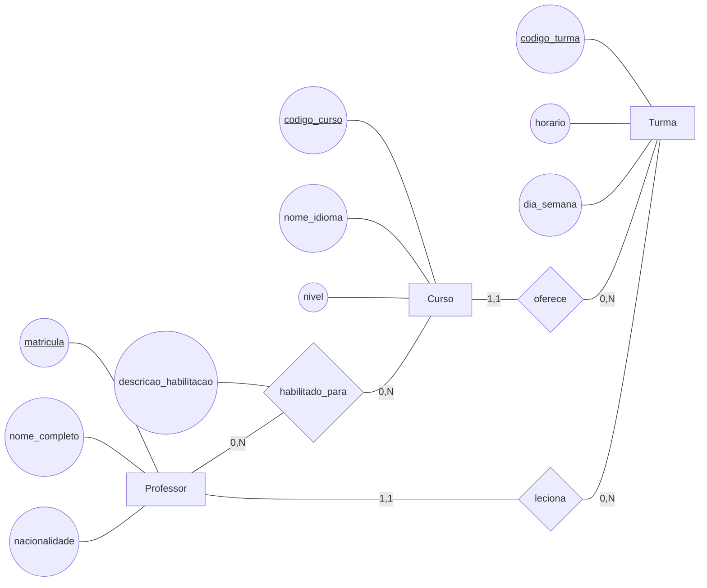
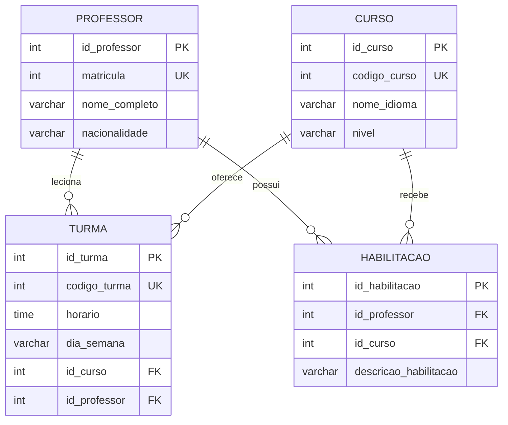

# Respostas da Dinâmica 2

## 1. Modelo conceitual — atividadeMER2

O cenário da escola de línguas possui as entidades `Professor`, `Curso` e `Turma`. A habilitação de um professor para lecionar um curso é um relacionamento N:N e possui o atributo próprio `descricao_habilitacao`, pois a descrição depende da combinação específica entre professor e curso.

### Diagrama conceitual



### Entidades, atributos e tipos conceituais

| Entidade | Atributo | Tipo | Identificador do domínio |
|---|---|---|:---:|
| Professor | matricula | INTEGER | Sim |
| Professor | nome_completo | VARCHAR(120) | Não |
| Professor | nacionalidade | VARCHAR(60) | Não |
| Curso | codigo_curso | INTEGER | Sim |
| Curso | nome_idioma | VARCHAR(80) | Não |
| Curso | nivel | VARCHAR(20) | Não |
| Turma | codigo_turma | INTEGER | Sim |
| Turma | horario | TIME | Não |
| Turma | dia_semana | VARCHAR(20) | Não |

O relacionamento `habilitado_para` possui o atributo `descricao_habilitacao`, do tipo `VARCHAR(500)`. Esse atributo não pertence isoladamente ao professor nem ao curso: um mesmo professor pode ter justificativas diferentes para cursos diferentes.

### Relacionamentos e cardinalidades

| Relacionamento | Cardinalidade | Interpretação |
|---|---|---|
| `Professor habilitado_para Curso` | Professor `(0,N)` — Curso `(0,N)` | Um professor pode estar habilitado para vários cursos e um curso pode ter vários professores habilitados. |
| `Curso oferece Turma` | Curso `(1,1)` — Turma `(0,N)` | Um curso pode ser oferecido em várias turmas; cada turma pertence a exatamente um curso. |
| `Professor leciona Turma` | Professor `(1,1)` — Turma `(0,N)` | Um professor pode lecionar várias turmas; cada turma é lecionada por exatamente um professor. |

O relacionamento entre `Professor` e `Curso` é N:N. Os outros dois relacionamentos são 1:N.

### Análise conceitual

Não faz sentido alocar um professor para uma turma de um curso para o qual ele não está habilitado. Entretanto, o MER apresentado registra separadamente a habilitação e a alocação da turma. Portanto, somente as cardinalidades e os relacionamentos do MER não impedem essa situação: as tabelas `Turma` e `Habilitacao` podem conter referências válidas individualmente, mas sem garantir que o par professor–curso da turma também exista em `Habilitacao`. Essa regra precisa de validação adicional na aplicação, em uma restrição mais elaborada ou em um mecanismo de banco de dados, como um gatilho (trigger).

## 2. Modelo lógico — atividadeModeloLogico2

As entidades conceituais originam as tabelas `professor`, `curso` e `turma`. O relacionamento N:N `habilitado_para` origina a tabela associativa `habilitacao`, que também armazena `descricao_habilitacao`.

Todas as tabelas utilizam chaves primárias artificiais inteiras:

- `id_professor` em `Professor`;
- `id_curso` em `Curso`;
- `id_turma` em `Turma`;
- `id_habilitacao` em `Habilitacao`.

Os identificadores do domínio permanecem como colunas próprias com restrição `UNIQUE`: `matricula`, `codigo_curso` e `codigo_turma`.

Os relacionamentos 1:N são representados pelas seguintes chaves estrangeiras na tabela `Turma`:

- `Turma.id_curso` referencia `Curso.id_curso`;
- `Turma.id_professor` referencia `Professor.id_professor`.

O relacionamento N:N é representado pela tabela `Habilitacao`, que possui uma chave estrangeira para cada entidade participante. O par `(id_professor, id_curso)` é `UNIQUE` para impedir o cadastro duplicado da mesma habilitação, enquanto `id_habilitacao` é a chave primária artificial da tabela.



`UK` representa uma restrição de unicidade. A tabela `Habilitacao` poderia usar uma chave primária composta por `(id_professor, id_curso)` na transformação relacional tradicional; neste modelo foi adotada a chave artificial `id_habilitacao`, conforme a regra de utilizar chaves primárias artificiais em todas as tabelas. A unicidade do par continua sendo necessária para preservar a regra de uma habilitação por professor e curso.

### Regras de transformação

1. Nos relacionamentos 1:N, as chaves de `Professor` e `Curso`, que estão no lado 1, são transpostas para `Turma`, que está no lado N.
2. No relacionamento N:N, a transposição de apenas uma chave não seria suficiente. A tabela `Habilitacao` permite registrar várias combinações entre professores e cursos.
3. O atributo `descricao_habilitacao` fica em `Habilitacao` porque descreve a associação, e não uma entidade isolada.
4. Com os dados de exemplo da atividade, podem ser registradas cinco habilitações: três para o professor de matrícula 1 e duas para o professor de matrícula 2.

## 3. Modelo físico — script SQL

Script compatível com PostgreSQL. As tabelas referenciadas são criadas antes das tabelas que possuem chaves estrangeiras.

```sql
-- Modelo físico da Escola de Línguas

CREATE TABLE professor (
    id_professor SERIAL PRIMARY KEY,
    matricula INTEGER NOT NULL UNIQUE,
    nome_completo VARCHAR(120) NOT NULL,
    nacionalidade VARCHAR(60) NOT NULL
);

CREATE TABLE curso (
    id_curso SERIAL PRIMARY KEY,
    codigo_curso INTEGER NOT NULL UNIQUE,
    nome_idioma VARCHAR(80) NOT NULL,
    nivel VARCHAR(20) NOT NULL
);

CREATE TABLE turma (
    id_turma SERIAL PRIMARY KEY,
    codigo_turma INTEGER NOT NULL UNIQUE,
    horario TIME NOT NULL,
    dia_semana VARCHAR(20) NOT NULL,
    id_curso INTEGER NOT NULL,
    id_professor INTEGER NOT NULL,
    CONSTRAINT fk_turma_curso
        FOREIGN KEY (id_curso)
        REFERENCES curso (id_curso)
        ON DELETE RESTRICT
        ON UPDATE CASCADE,
    CONSTRAINT fk_turma_professor
        FOREIGN KEY (id_professor)
        REFERENCES professor (id_professor)
        ON DELETE RESTRICT
        ON UPDATE CASCADE
);

CREATE TABLE habilitacao (
    id_habilitacao SERIAL PRIMARY KEY,
    id_professor INTEGER NOT NULL,
    id_curso INTEGER NOT NULL,
    descricao_habilitacao VARCHAR(500) NOT NULL,
    CONSTRAINT uq_habilitacao_professor_curso
        UNIQUE (id_professor, id_curso),
    CONSTRAINT fk_habilitacao_professor
        FOREIGN KEY (id_professor)
        REFERENCES professor (id_professor)
        ON DELETE CASCADE
        ON UPDATE CASCADE,
    CONSTRAINT fk_habilitacao_curso
        FOREIGN KEY (id_curso)
        REFERENCES curso (id_curso)
        ON DELETE CASCADE
        ON UPDATE CASCADE
);
```

As chaves estrangeiras `turma.id_curso`, `turma.id_professor`, `habilitacao.id_professor` e `habilitacao.id_curso` são `NOT NULL` porque cada turma precisa estar associada a um curso e a um professor, e cada registro de habilitação precisa identificar os dois participantes.

As chaves estrangeiras garantem que a turma, o professor, o curso e a habilitação referenciem registros existentes. Elas não garantem sozinhas que o professor escolhido para uma turma esteja habilitado para o curso escolhido para a mesma turma; essa é a restrição adicional destacada na análise conceitual.
