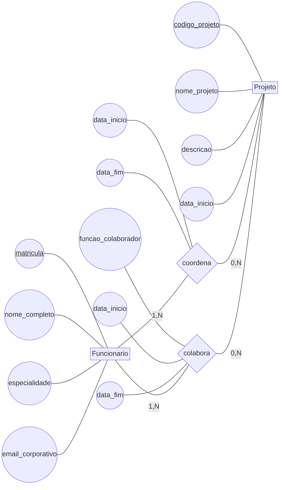
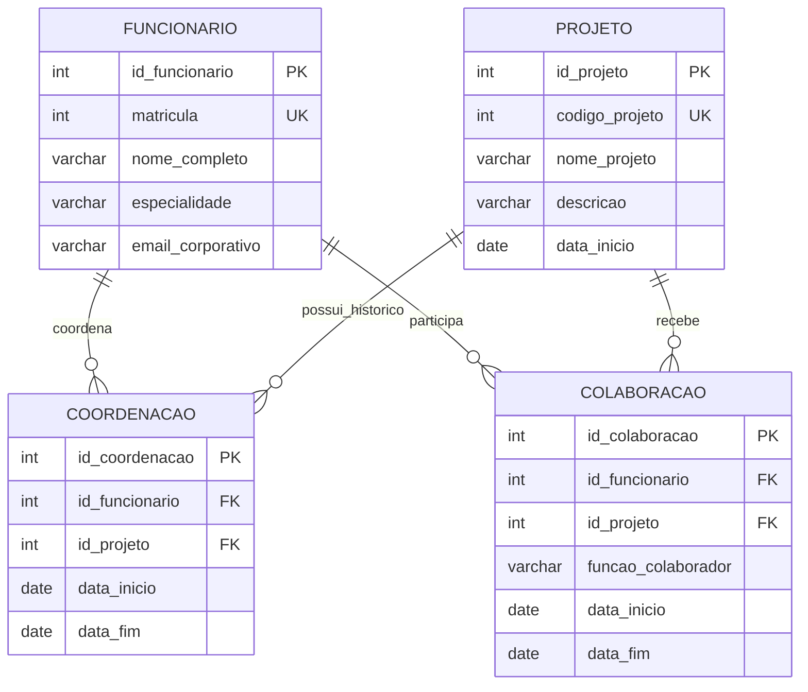

# Respostas da Dinâmica 3

## 1. Modelo conceitual — atividadeMER3

O cenário possui as entidades `Funcionario` e `Projeto`, ligadas por dois relacionamentos diferentes: `coordena` e `colabora`. Embora envolvam as mesmas entidades, os relacionamentos representam papéis distintos e, por isso, devem permanecer separados.

Na versão histórica do modelo, tanto a coordenação quanto a colaboração podem possuir várias ocorrências ao longo do tempo. Os atributos `data_inicio` e `data_fim` pertencem às ocorrências dos relacionamentos, e não diretamente ao funcionário ou ao projeto.

### Diagrama conceitual da versão histórica



### Entidades, atributos e tipos conceituais

| Entidade | Atributo | Tipo | Identificador do domínio |
|---|---|---|:---:|
| Funcionario | matricula | INTEGER | Sim |
| Funcionario | nome_completo | VARCHAR(120) | Não |
| Funcionario | especialidade | VARCHAR(100) | Não |
| Funcionario | email_corporativo | VARCHAR(150) | Não |
| Projeto | codigo_projeto | INTEGER | Sim |
| Projeto | nome_projeto | VARCHAR(120) | Não |
| Projeto | descricao | VARCHAR(500) | Não |
| Projeto | data_inicio | DATE | Não |

### Atributos dos relacionamentos

| Relacionamento | Atributo | Tipo | Observação |
|---|---|---|---|
| `coordena` | data_inicio | DATE | Início do período de coordenação. |
| `coordena` | data_fim | DATE | Fim do período; pode ficar vazio quando a coordenação está vigente. |
| `colabora` | funcao_colaborador | VARCHAR(100) | Função exercida pelo funcionário naquele projeto. |
| `colabora` | data_inicio | DATE | Início do período de colaboração. |
| `colabora` | data_fim | DATE | Fim do período; pode ficar vazio quando a colaboração está vigente. |

### Relacionamentos e cardinalidades

| Relacionamento | Cardinalidade | Interpretação |
|---|---|---|
| `Funcionario coordena Projeto` | Funcionario `(1,N)` — Projeto `(0,N)` | Um funcionário pode coordenar vários projetos ou nenhum. Um projeto possui um ou mais registros de coordenação ao longo de seu histórico. |
| `Funcionario colabora Projeto` | Funcionario `(1,N)` — Projeto `(0,N)` | Um funcionário pode colaborar em vários projetos e um projeto pode possuir vários colaboradores. |

Na primeira versão, `coordena` representava apenas o coordenador atual e podia ser modelado como um relacionamento 1:N : cada projeto tinha um coordenador e um funcionário podia coordenar vários projetos. Com a necessidade de histórico, o mesmo projeto pode possuir vários coordenadores em períodos diferentes; por isso, `coordena` passa a ser N:N e recebe `data_inicio` e `data_fim`.

O modelo não deve permitir períodos de coordenação sobrepostos para o mesmo projeto. Essa regra é adicional às cardinalidades e precisa ser validada por uma restrição específica, por um gatilho ou pela aplicação. Também deve existir somente uma coordenação vigente por projeto, identificada por `data_fim` vazio.

## 2. Modelo lógico — atividadeModeloLogico3

As entidades conceituais originam as tabelas `funcionario` e `projeto`. Como existem dois relacionamentos N:N entre as mesmas entidades, cada relacionamento origina uma tabela associativa própria:

- `coordenacao` representa o histórico de coordenação;
- `colaboracao` representa o histórico de colaboração, incluindo a função exercida.

Todas as tabelas possuem chaves primárias artificiais:

- `id_funcionario` em `Funcionario`;
- `id_projeto` em `Projeto`;
- `id_coordenacao` em `Coordenacao`;
- `id_colaboracao` em `Colaboracao`.

Os identificadores de domínio `matricula` e `codigo_projeto` permanecem nas tabelas de origem com restrição `UNIQUE`. Os pares funcionário–projeto não são definidos como `UNIQUE`, pois o mesmo funcionário pode ter mais de um período de coordenação ou colaboração no mesmo projeto ao longo do tempo.



`UK` representa uma restrição de unicidade. As duas tabelas associativas recebem chaves estrangeiras para `funcionario` e `projeto`, mas os atributos e os nomes das tabelas deixam claro qual papel cada associação representa.

### Regras de transformação

1. `Funcionario` e `Projeto` originam tabelas independentes.
2. `coordena` e `colabora` são mapeados separadamente porque possuem significados e atributos diferentes.
3. `data_inicio` e `data_fim` ficam em `coordenacao` ou `colaboracao`, pois descrevem cada período da associação.
4. `funcao_colaborador` fica somente em `colaboracao`, pois um funcionário pode exercer funções diferentes em projetos diferentes.
5. Uma linha em `coordenacao` registra um período específico de coordenação; várias linhas permitem reconstruir o histórico do projeto.
6. Uma linha em `colaboracao` registra uma função e um período específicos, permitindo que o mesmo funcionário colabore em projetos distintos ou retorne ao mesmo projeto em outro período.

### Exemplos de interpretação

O mesmo funcionário pode ser coordenador do Projeto A e colaborador do Projeto B, pois as relações são armazenadas em tabelas associativas independentes. Também é possível registrar dois coordenadores diferentes para o Projeto A em períodos consecutivos, sem sobrescrever a coordenação anterior.

Para consultar o coordenador vigente de um projeto, basta filtrar a tabela `coordenacao` por `id_projeto` e `data_fim IS NULL`. Para consultar quem coordenava o projeto em uma data específica, deve-se procurar o registro cujo período contenha a data consultada.

## 3. Modelo físico — script SQL

Script compatível com PostgreSQL. `data_fim` é opcional para representar períodos ainda vigentes. As restrições `CHECK` impedem que uma data final seja anterior à data inicial, mas não substituem a validação de sobreposição de períodos.

```sql
-- Modelo físico da Empresa de Projetos

CREATE TABLE funcionario (
    id_funcionario SERIAL PRIMARY KEY,
    matricula INTEGER NOT NULL UNIQUE,
    nome_completo VARCHAR(120) NOT NULL,
    especialidade VARCHAR(100) NOT NULL,
    email_corporativo VARCHAR(150) NOT NULL
);

CREATE TABLE projeto (
    id_projeto SERIAL PRIMARY KEY,
    codigo_projeto INTEGER NOT NULL UNIQUE,
    nome_projeto VARCHAR(120) NOT NULL,
    descricao VARCHAR(500) NOT NULL,
    data_inicio DATE NOT NULL
);

CREATE TABLE coordenacao (
    id_coordenacao SERIAL PRIMARY KEY,
    id_funcionario INTEGER NOT NULL,
    id_projeto INTEGER NOT NULL,
    data_inicio DATE NOT NULL,
    data_fim DATE,
    CONSTRAINT ck_coordenacao_periodo
        CHECK (data_fim IS NULL OR data_fim >= data_inicio),
    CONSTRAINT fk_coordenacao_funcionario
        FOREIGN KEY (id_funcionario)
        REFERENCES funcionario (id_funcionario)
        ON DELETE CASCADE
        ON UPDATE CASCADE,
    CONSTRAINT fk_coordenacao_projeto
        FOREIGN KEY (id_projeto)
        REFERENCES projeto (id_projeto)
        ON DELETE CASCADE
        ON UPDATE CASCADE
);

CREATE TABLE colaboracao (
    id_colaboracao SERIAL PRIMARY KEY,
    id_funcionario INTEGER NOT NULL,
    id_projeto INTEGER NOT NULL,
    funcao_colaborador VARCHAR(100) NOT NULL,
    data_inicio DATE NOT NULL,
    data_fim DATE,
    CONSTRAINT ck_colaboracao_periodo
        CHECK (data_fim IS NULL OR data_fim >= data_inicio),
    CONSTRAINT fk_colaboracao_funcionario
        FOREIGN KEY (id_funcionario)
        REFERENCES funcionario (id_funcionario),
    CONSTRAINT fk_colaboracao_projeto
        FOREIGN KEY (id_projeto)
        REFERENCES projeto (id_projeto)
);
```

As chaves estrangeiras garantem que cada registro de coordenação ou colaboração aponte para um funcionário e um projeto existentes. Entretanto, as chaves estrangeiras não impedem, sozinhas, períodos sobrepostos nem garantem que exista somente uma coordenação vigente por projeto. Essas regras exigem validação adicional, como uma trigger, uma exclusão de sobreposição no PostgreSQL ou uma validação transacional na aplicação.
