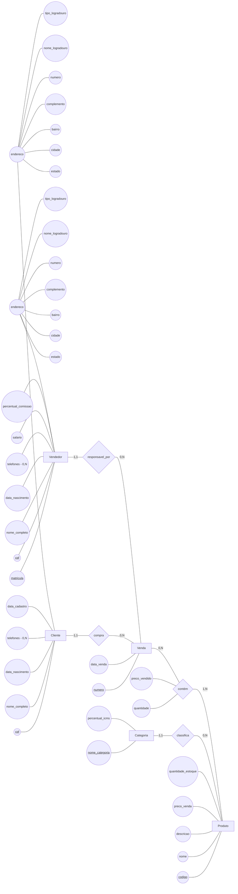
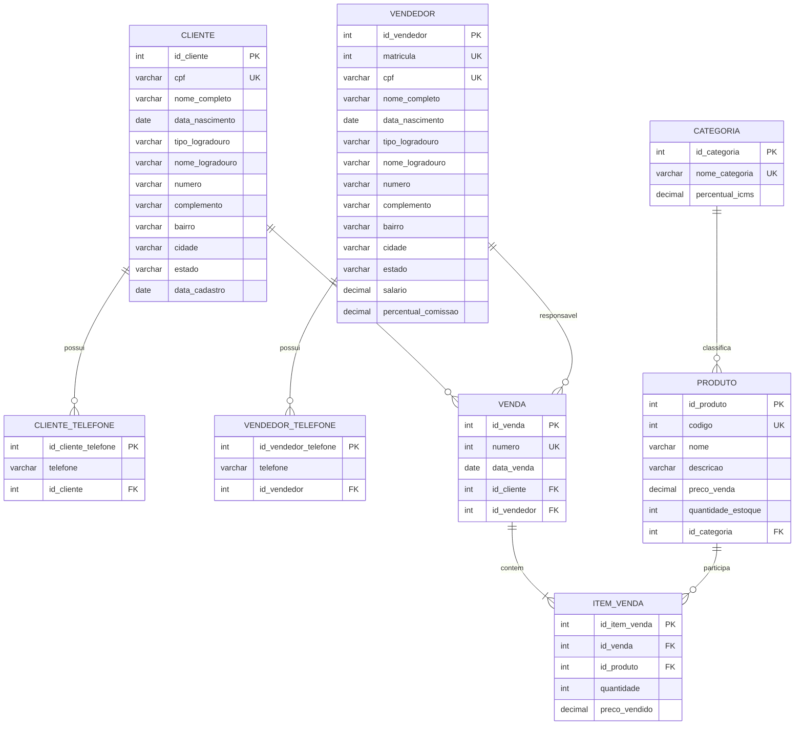

# Respostas da Dinâmica 4

## 1. Modelo conceitual — atividadeMER4

O cenário da loja possui as entidades `Cliente`, `Vendedor`, `Produto`, `Categoria` e `Venda`. O endereço de clientes e vendedores é um atributo composto, enquanto os telefones são atributos multivalorados. A venda de produtos é representada por um relacionamento N:N com atributos próprios.

Para evitar o armazenamento de um atributo calculado, o modelo utiliza `data_nascimento` em `Cliente` e `Vendedor`, e não `idade`. A idade pode ser calculada quando for necessária.

### Diagrama conceitual



### Entidades, atributos e tipos conceituais

| Entidade | Atributo | Tipo | Identificador do domínio |
|---|---|---|:---:|
| Cliente | cpf | VARCHAR(14) | Sim |
| Cliente | nome_completo | VARCHAR(120) | Não |
| Cliente | data_nascimento | DATE | Não |
| Cliente | endereco | Composto | Não |
| Cliente | telefones | VARCHAR(20), multivalorado `(0,N)` | Não |
| Cliente | data_cadastro | DATE | Não |
| Vendedor | matricula | INTEGER | Sim |
| Vendedor | cpf | VARCHAR(14) | Sim |
| Vendedor | nome_completo | VARCHAR(120) | Não |
| Vendedor | data_nascimento | DATE | Não |
| Vendedor | endereco | Composto | Não |
| Vendedor | telefones | VARCHAR(20), multivalorado `(0,N)` | Não |
| Vendedor | salario | DECIMAL(12,2) | Não |
| Vendedor | percentual_comissao | DECIMAL(5,2) | Não |
| Produto | codigo | INTEGER | Sim |
| Produto | nome | VARCHAR(120) | Não |
| Produto | descricao | VARCHAR(500) | Não |
| Produto | preco_venda | DECIMAL(12,2) | Não |
| Produto | quantidade_estoque | INTEGER | Não |
| Categoria | nome_categoria | VARCHAR(80) | Sim* |
| Categoria | percentual_icms | DECIMAL(5,2) | Não |
| Venda | numero | INTEGER | Sim |
| Venda | data_venda | DATE | Não |

O atributo composto `endereco` possui as partes `tipo_logradouro`, `nome_logradouro`, `numero`, `complemento`, `bairro`, `cidade` e `estado`. O asterisco em `nome_categoria` indica uma decisão de modelagem: como o cenário não fornece um código de categoria, considera-se que o nome identifica unicamente cada categoria.

### Relacionamentos e cardinalidades

| Relacionamento | Cardinalidade | Interpretação |
|---|---|---|
| `Cliente compra Venda` | Cliente `(1,1)` — Venda `(0,N)` | Um cliente pode realizar várias vendas; cada venda possui um cliente comprador. |
| `Vendedor responsavel_por Venda` | Vendedor `(1,1)` — Venda `(0,N)` | Um vendedor pode ser responsável por várias vendas; cada venda possui um vendedor responsável. |
| `Categoria classifica Produto` | Categoria `(1,1)` — Produto `(0,N)` | Uma categoria pode classificar vários produtos; cada produto pertence a uma categoria. |
| `Venda contém Produto` | Venda `(0,N)` — Produto `(1,N)` | Uma venda contém um ou mais produtos; um produto pode aparecer em várias vendas. |

O relacionamento `contém` possui os atributos `quantidade` e `preco_vendido`, pois esses valores dependem da combinação específica entre uma venda e um produto.

### Análise conceitual

- `endereco` é um atributo composto, e não uma entidade, porque neste cenário ele é apenas uma característica de cliente ou vendedor. Não é necessário cadastrar endereços independentemente, compartilhá-los ou acompanhar seu histórico.
- `idade` não é armazenada. A informação deve ser obtida a partir de `data_nascimento`, evitando que o valor fique desatualizado.
- `preco_venda` representa o preço atual do produto. Já `preco_vendido` registra o preço praticado em cada item de venda; por isso, uma alteração do preço atual não modifica o histórico.
- Os telefones são multivalorados porque cada cliente ou vendedor pode ter zero ou vários números. Cada número será armazenado separadamente no modelo lógico.

## 2. Modelo lógico — atividadeModeloLogico4

Os atributos compostos são decompostos em suas partes e essas partes tornam-se colunas nas tabelas de `Cliente` e `Vendedor`. Não é criada uma coluna única chamada `endereco`.

Cada atributo multivalorado `telefones` é representado por uma tabela própria. Foram escolhidas duas tabelas, `cliente_telefone` e `vendedor_telefone`, para manter explícita a entidade proprietária e evitar uma associação polimórfica ambígua.

Todas as tabelas possuem chaves primárias artificiais. Os identificadores de domínio recebem `UNIQUE`:

- `Cliente.cpf`;
- `Vendedor.matricula` e `Vendedor.cpf`;
- `Produto.codigo`;
- `Categoria.nome_categoria`;
- `Venda.numero`.

As tabelas de telefone possuem uma restrição adicional `UNIQUE` no par formado pela chave estrangeira e pelo número. Assim, o mesmo telefone pode pertencer a pessoas diferentes, mas não pode ser repetido para a mesma pessoa.



O modelo lógico não usa a idade nem uma coluna `endereco`. A idade é derivada de `data_nascimento`, e as partes do endereço são armazenadas diretamente nas tabelas das entidades.

O relacionamento N:N entre `Venda` e `Produto` origina `item_venda`, onde ficam `quantidade` e `preco_vendido`. Como todas as tabelas usam chaves artificiais, `id_item_venda` é a PK e o par `(id_venda, id_produto)` recebe uma restrição `UNIQUE` para impedir o mesmo produto duplicado na mesma venda.

## 3. Modelo físico — script SQL

Script compatível com PostgreSQL. O endereço é armazenado por partes, os telefones ficam em tabelas próprias e o preço histórico fica em `item_venda`.

```sql
-- Modelo físico da Loja Varejista

CREATE TABLE cliente (
    id_cliente SERIAL PRIMARY KEY,
    cpf VARCHAR(14) NOT NULL UNIQUE,
    nome_completo VARCHAR(120) NOT NULL,
    data_nascimento DATE NOT NULL,
    tipo_logradouro VARCHAR(30) NOT NULL,
    nome_logradouro VARCHAR(120) NOT NULL,
    numero VARCHAR(10) NOT NULL,
    complemento VARCHAR(80),
    bairro VARCHAR(80) NOT NULL,
    cidade VARCHAR(80) NOT NULL,
    estado CHAR(2) NOT NULL,
    data_cadastro DATE NOT NULL
);

CREATE TABLE vendedor (
    id_vendedor SERIAL PRIMARY KEY,
    matricula INTEGER NOT NULL UNIQUE,
    cpf VARCHAR(14) NOT NULL UNIQUE,
    nome_completo VARCHAR(120) NOT NULL,
    data_nascimento DATE NOT NULL,
    tipo_logradouro VARCHAR(30) NOT NULL,
    nome_logradouro VARCHAR(120) NOT NULL,
    numero VARCHAR(10) NOT NULL,
    complemento VARCHAR(80),
    bairro VARCHAR(80) NOT NULL,
    cidade VARCHAR(80) NOT NULL,
    estado CHAR(2) NOT NULL,
    salario NUMERIC(12,2) NOT NULL CHECK (salario >= 0),
    percentual_comissao NUMERIC(5,2) NOT NULL
        CHECK (percentual_comissao >= 0 AND percentual_comissao <= 100)
);

CREATE TABLE categoria (
    id_categoria SERIAL PRIMARY KEY,
    nome_categoria VARCHAR(80) NOT NULL UNIQUE,
    percentual_icms NUMERIC(5,2) NOT NULL
        CHECK (percentual_icms >= 0 AND percentual_icms <= 100)
);

CREATE TABLE produto (
    id_produto SERIAL PRIMARY KEY,
    codigo INTEGER NOT NULL UNIQUE,
    nome VARCHAR(120) NOT NULL,
    descricao VARCHAR(500) NOT NULL,
    preco_venda NUMERIC(12,2) NOT NULL CHECK (preco_venda >= 0),
    quantidade_estoque INTEGER NOT NULL CHECK (quantidade_estoque >= 0),
    id_categoria INTEGER NOT NULL,
    CONSTRAINT fk_produto_categoria
        FOREIGN KEY (id_categoria)
        REFERENCES categoria (id_categoria)
        ON DELETE RESTRICT
        ON UPDATE CASCADE
);

CREATE TABLE venda (
    id_venda SERIAL PRIMARY KEY,
    numero INTEGER NOT NULL UNIQUE,
    data_venda DATE NOT NULL,
    id_cliente INTEGER NOT NULL,
    id_vendedor INTEGER NOT NULL,
    CONSTRAINT fk_venda_cliente
        FOREIGN KEY (id_cliente)
        REFERENCES cliente (id_cliente)
        ON DELETE RESTRICT
        ON UPDATE CASCADE,
    CONSTRAINT fk_venda_vendedor
        FOREIGN KEY (id_vendedor)
        REFERENCES vendedor (id_vendedor)
        ON DELETE RESTRICT
        ON UPDATE CASCADE
);

CREATE TABLE cliente_telefone (
    id_cliente_telefone SERIAL PRIMARY KEY,
    id_cliente INTEGER NOT NULL,
    telefone VARCHAR(20) NOT NULL,
    CONSTRAINT uq_cliente_telefone
        UNIQUE (id_cliente, telefone),
    CONSTRAINT fk_cliente_telefone_cliente
        FOREIGN KEY (id_cliente)
        REFERENCES cliente (id_cliente)
        ON DELETE CASCADE
        ON UPDATE CASCADE
);

CREATE TABLE vendedor_telefone (
    id_vendedor_telefone SERIAL PRIMARY KEY,
    id_vendedor INTEGER NOT NULL,
    telefone VARCHAR(20) NOT NULL,
    CONSTRAINT uq_vendedor_telefone
        UNIQUE (id_vendedor, telefone),
    CONSTRAINT fk_vendedor_telefone_vendedor
        FOREIGN KEY (id_vendedor)
        REFERENCES vendedor (id_vendedor)
        ON DELETE CASCADE
        ON UPDATE CASCADE
);

CREATE TABLE item_venda (
    id_item_venda SERIAL PRIMARY KEY,
    id_venda INTEGER NOT NULL,
    id_produto INTEGER NOT NULL,
    quantidade INTEGER NOT NULL CHECK (quantidade > 0),
    preco_vendido NUMERIC(12,2) NOT NULL CHECK (preco_vendido >= 0),
    CONSTRAINT uq_item_venda_produto
        UNIQUE (id_venda, id_produto),
    CONSTRAINT fk_item_venda_venda
        FOREIGN KEY (id_venda)
        REFERENCES venda (id_venda)
        ON DELETE CASCADE
        ON UPDATE CASCADE,
    CONSTRAINT fk_item_venda_produto
        FOREIGN KEY (id_produto)
        REFERENCES produto (id_produto)
        ON DELETE RESTRICT
        ON UPDATE CASCADE
);
```

As restrições de unicidade dos telefones são específicas de cada proprietário. Portanto, um mesmo número pode aparecer em `cliente_telefone` para clientes diferentes, mas não duas vezes para o mesmo cliente; a mesma regra vale para `vendedor_telefone`.
