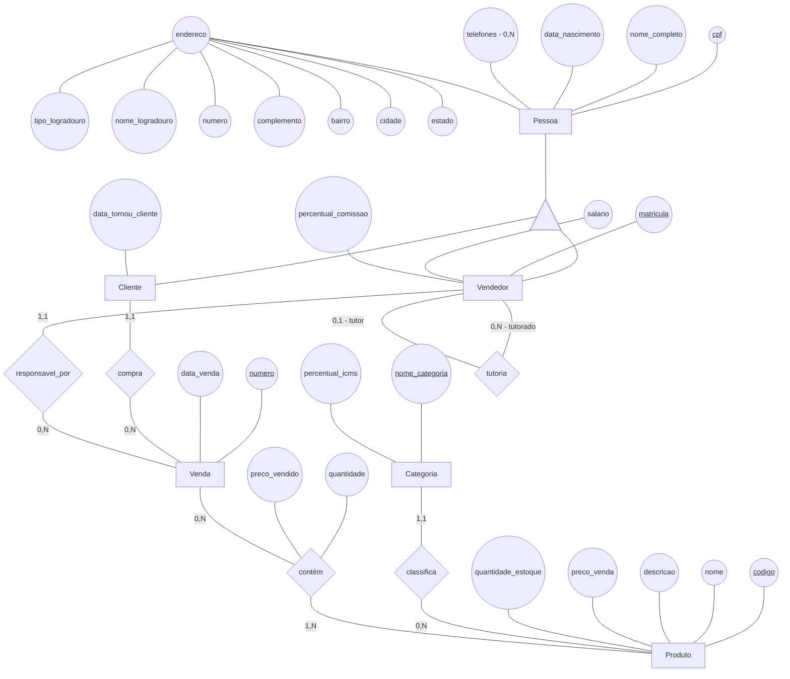
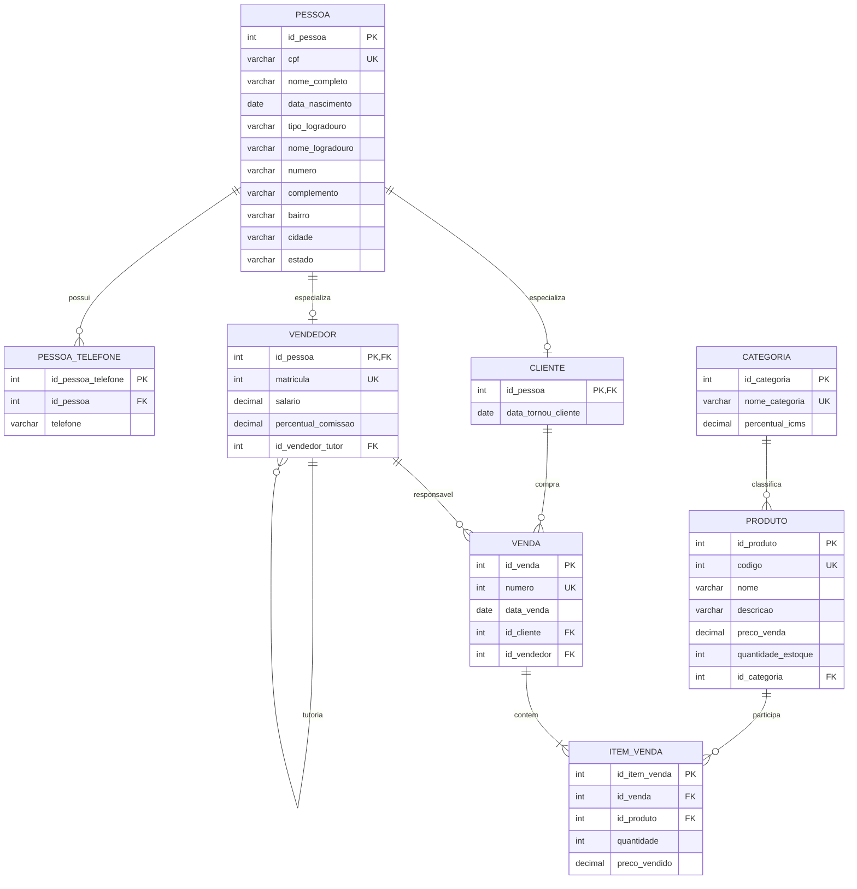

# Respostas da Dinâmica 5

## 1. Modelo conceitual — atividadeMER5

O modelo conceitual parte do cenário da loja varejista e acrescenta uma hierarquia de generalização. `Pessoa` é a entidade pai, enquanto `Cliente` e `Vendedor` são entidades filhas que herdam os atributos comuns.

Uma mesma pessoa pode exercer os dois papéis ao mesmo tempo. Por isso, uma ocorrência de `Pessoa` pode estar associada a uma ocorrência de `Cliente`, a uma ocorrência de `Vendedor` ou às duas entidades.

O relacionamento `tutoria` é um autorrelacionamento da entidade `Vendedor`, pois relaciona duas ocorrências da própria entidade. Em cada ocorrência, um vendedor exerce o papel de `tutor` e outro exerce o papel de `tutorado`: um tutor pode acompanhar vários vendedores, enquanto um tutorado pode ter nenhum ou um tutor.

### Diagrama conceitual



O triângulo representa a generalização/especialização: toda ocorrência de `Cliente` e toda ocorrência de `Vendedor` também é uma ocorrência de `Pessoa`.

### Entidades e atributos

| Entidade | Atributo | Tipo | Identificador do domínio |
|---|---|---|:---:|
| Pessoa | cpf | VARCHAR(14) | Sim |
| Pessoa | nome_completo | VARCHAR(120) | Não |
| Pessoa | data_nascimento | DATE | Não |
| Pessoa | endereco | Composto | Não |
| Pessoa | telefones | VARCHAR(20), multivalorado `(0,N)` | Não |
| Cliente | data_tornou_cliente | DATE | Não |
| Vendedor | matricula | INTEGER | Sim |
| Vendedor | salario | DECIMAL(12,2) | Não |
| Vendedor | percentual_comissao | DECIMAL(5,2) | Não |
| Produto | codigo | INTEGER | Sim |
| Produto | nome | VARCHAR(120) | Não |
| Produto | descricao | VARCHAR(500) | Não |
| Produto | preco_venda | DECIMAL(12,2) | Não |
| Produto | quantidade_estoque | INTEGER | Não |
| Categoria | nome_categoria | VARCHAR(80) | Sim* |
| Categoria | percentual_icms | DECIMAL(5,2) | Não |
| Venda | numero | INTEGER | Sim |
| Venda | data_venda | DATE | Não |

O atributo composto `endereco`, herdado por `Cliente` e `Vendedor`, é formado por `tipo_logradouro`, `nome_logradouro`, `numero`, `complemento`, `bairro`, `cidade` e `estado`. O atributo multivalorado `telefones` também pertence à entidade pai `Pessoa`.

O asterisco em `nome_categoria` indica uma decisão de modelagem: como o cenário não fornece um código de categoria, considera-se que o nome identifica unicamente a categoria.

### Relacionamentos e cardinalidades

| Relacionamento | Cardinalidade | Interpretação |
|---|---|---|
| `Cliente compra Venda` | Cliente `(1,1)` — Venda `(0,N)` | Um cliente pode realizar várias vendas; cada venda possui um cliente comprador. |
| `Vendedor responsavel_por Venda` | Vendedor `(1,1)` — Venda `(0,N)` | Um vendedor pode ser responsável por várias vendas; cada venda possui um vendedor responsável. |
| `Categoria classifica Produto` | Categoria `(1,1)` — Produto `(0,N)` | Uma categoria pode classificar vários produtos; cada produto pertence a uma categoria. |
| `Venda contém Produto` | Venda `(0,N)` — Produto `(1,N)` | Uma venda contém um ou mais produtos; um produto pode participar de várias vendas. |
| `Vendedor tutoria Vendedor` | Tutor `(0,1)` — Tutorado `(0,N)` | Um vendedor pode ser tutor de vários vendedores; cada vendedor pode ter nenhum ou um tutor. |

O relacionamento `contém` possui os atributos `quantidade` e `preco_vendido`, pois eles descrevem cada produto dentro de uma venda. O relacionamento `tutoria` é um autorrelacionamento: suas duas extremidades pertencem à entidade `Vendedor`, mas exercem papéis diferentes.

## 2. Modelo lógico — estratégia: uma tabela para cada entidade da hierarquia

Foi escolhida a estratégia de criar uma tabela para cada entidade da hierarquia:

1. `pessoa` armazena os atributos comuns;
2. `cliente` armazena os atributos específicos de Cliente;
3. `vendedor` armazena os atributos específicos de Vendedor;
4. a chave artificial `id_pessoa` é repetida em `cliente` e `vendedor`, funcionando simultaneamente como PK e FK para `pessoa`.

Essa estratégia evita a duplicação dos atributos comuns e permite que a mesma pessoa apareça nos dois papéis. Para representar os telefones herdados, foi criada uma tabela `pessoa_telefone`, vinculada diretamente à tabela pai.

Todas as tabelas possuem chaves primárias artificiais. Nas tabelas filhas, a chave artificial herdada `id_pessoa` atua como PK e FK; não é criada uma segunda chave para o mesmo papel. Os identificadores de domínio recebem `UNIQUE`:

- `Pessoa.cpf`;
- `Vendedor.matricula`;
- `Produto.codigo`;
- `Categoria.nome_categoria`;
- `Venda.numero`.



No autorrelacionamento `tutoria`, `vendedor.id_vendedor_tutor` referencia `vendedor.id_pessoa`. O nome deixa claro que a coluna representa o papel de tutor, enquanto a própria tabela armazena tanto os tutores quanto os tutorados.

O par `(id_venda, id_produto)` recebe uma restrição `UNIQUE` em `item_venda`, pois uma venda deve possuir no máximo uma linha para cada produto. Os pares `(id_pessoa, telefone)` também são únicos em `pessoa_telefone`, permitindo o mesmo número para pessoas diferentes, mas não repetido para a mesma pessoa.

### Por que esta estratégia foi escolhida?

A estratégia de uma tabela para cada entidade é adequada porque os atributos comuns de `Pessoa` são importantes e devem ser armazenados uma única vez. Ela também representa corretamente a possibilidade de uma pessoa ser simultaneamente cliente e vendedor: há uma linha em `pessoa` e linhas correspondentes em `cliente` e `vendedor`, todas ligadas pelo mesmo `id_pessoa`.

Além disso, pessoas que não exerçam nenhum dos dois papéis ainda podem existir na tabela `pessoa`. A desvantagem é a necessidade de junções para obter os dados completos de um cliente ou vendedor.

## 3. Modelo físico — script SQL

Script compatível com PostgreSQL. A criação respeita a hierarquia: primeiro `pessoa`, depois as tabelas filhas e as demais tabelas relacionadas.

```sql
-- Modelo físico da Loja Varejista com herança e autorrelacionamento

CREATE TABLE pessoa (
    id_pessoa SERIAL PRIMARY KEY,
    cpf VARCHAR(14) NOT NULL UNIQUE,
    nome_completo VARCHAR(120) NOT NULL,
    data_nascimento DATE NOT NULL,
    tipo_logradouro VARCHAR(30) NOT NULL,
    nome_logradouro VARCHAR(120) NOT NULL,
    numero VARCHAR(10) NOT NULL,
    complemento VARCHAR(80),
    bairro VARCHAR(80) NOT NULL,
    cidade VARCHAR(80) NOT NULL,
    estado CHAR(2) NOT NULL
);

CREATE TABLE cliente (
    id_pessoa INTEGER PRIMARY KEY,
    data_tornou_cliente DATE NOT NULL,
    CONSTRAINT fk_cliente_pessoa
        FOREIGN KEY (id_pessoa)
        REFERENCES pessoa (id_pessoa)
        ON DELETE CASCADE
        ON UPDATE CASCADE
);

CREATE TABLE vendedor (
    id_pessoa INTEGER PRIMARY KEY,
    matricula INTEGER NOT NULL UNIQUE,
    salario NUMERIC(12,2) NOT NULL CHECK (salario >= 0),
    percentual_comissao NUMERIC(5,2) NOT NULL
        CHECK (percentual_comissao >= 0 AND percentual_comissao <= 100),
    id_vendedor_tutor INTEGER,
    CONSTRAINT fk_vendedor_pessoa
        FOREIGN KEY (id_pessoa)
        REFERENCES pessoa (id_pessoa)
        ON DELETE CASCADE
        ON UPDATE CASCADE,
    CONSTRAINT fk_vendedor_tutor
        FOREIGN KEY (id_vendedor_tutor)
        REFERENCES vendedor (id_pessoa)
        ON DELETE SET NULL
        ON UPDATE CASCADE,
    CONSTRAINT ck_vendedor_nao_eh_seu_proprio_tutor
        CHECK (id_vendedor_tutor IS NULL OR id_vendedor_tutor <> id_pessoa)
);

CREATE TABLE pessoa_telefone (
    id_pessoa_telefone SERIAL PRIMARY KEY,
    id_pessoa INTEGER NOT NULL,
    telefone VARCHAR(20) NOT NULL,
    CONSTRAINT uq_pessoa_telefone
        UNIQUE (id_pessoa, telefone),
    CONSTRAINT fk_pessoa_telefone_pessoa
        FOREIGN KEY (id_pessoa)
        REFERENCES pessoa (id_pessoa)
        ON DELETE CASCADE
        ON UPDATE CASCADE
);

CREATE TABLE categoria (
    id_categoria SERIAL PRIMARY KEY,
    nome_categoria VARCHAR(80) NOT NULL UNIQUE,
    percentual_icms NUMERIC(5,2) NOT NULL
        CHECK (percentual_icms >= 0 AND percentual_icms <= 100)
);

CREATE TABLE produto (
    id_produto SERIAL PRIMARY KEY,
    codigo INTEGER NOT NULL UNIQUE,
    nome VARCHAR(120) NOT NULL,
    descricao VARCHAR(500) NOT NULL,
    preco_venda NUMERIC(12,2) NOT NULL CHECK (preco_venda >= 0),
    quantidade_estoque INTEGER NOT NULL CHECK (quantidade_estoque >= 0),
    id_categoria INTEGER NOT NULL,
    CONSTRAINT fk_produto_categoria
        FOREIGN KEY (id_categoria)
        REFERENCES categoria (id_categoria)
        ON DELETE RESTRICT
        ON UPDATE CASCADE
);

CREATE TABLE venda (
    id_venda SERIAL PRIMARY KEY,
    numero INTEGER NOT NULL UNIQUE,
    data_venda DATE NOT NULL,
    id_cliente INTEGER NOT NULL,
    id_vendedor INTEGER NOT NULL,
    CONSTRAINT fk_venda_cliente
        FOREIGN KEY (id_cliente)
        REFERENCES cliente (id_pessoa)
        ON DELETE RESTRICT
        ON UPDATE CASCADE,
    CONSTRAINT fk_venda_vendedor
        FOREIGN KEY (id_vendedor)
        REFERENCES vendedor (id_pessoa)
        ON DELETE RESTRICT
        ON UPDATE CASCADE
);

CREATE TABLE item_venda (
    id_item_venda SERIAL PRIMARY KEY,
    id_venda INTEGER NOT NULL,
    id_produto INTEGER NOT NULL,
    quantidade INTEGER NOT NULL CHECK (quantidade > 0),
    preco_vendido NUMERIC(12,2) NOT NULL CHECK (preco_vendido >= 0),
    CONSTRAINT uq_item_venda_produto
        UNIQUE (id_venda, id_produto),
    CONSTRAINT fk_item_venda_venda
        FOREIGN KEY (id_venda)
        REFERENCES venda (id_venda)
        ON DELETE CASCADE
        ON UPDATE CASCADE,
    CONSTRAINT fk_item_venda_produto
        FOREIGN KEY (id_produto)
        REFERENCES produto (id_produto)
        ON DELETE RESTRICT
        ON UPDATE CASCADE
);
```

Para cadastrar uma pessoa como cliente ou vendedor, primeiro deve existir a linha correspondente em `pessoa`. Depois, o mesmo `id_pessoa` é inserido na tabela filha adequada. Se a pessoa exercer os dois papéis, o mesmo `id_pessoa` aparece em `cliente` e `vendedor`, sem duplicar CPF, nome ou endereço.

Na tutoria, `id_vendedor_tutor` pode ficar `NULL` quando o vendedor não possui tutor. Quando preenchido, ele precisa referenciar um vendedor já cadastrado; portanto, uma tentativa de cadastrar um tutor inexistente é rejeitada pela chave estrangeira.
