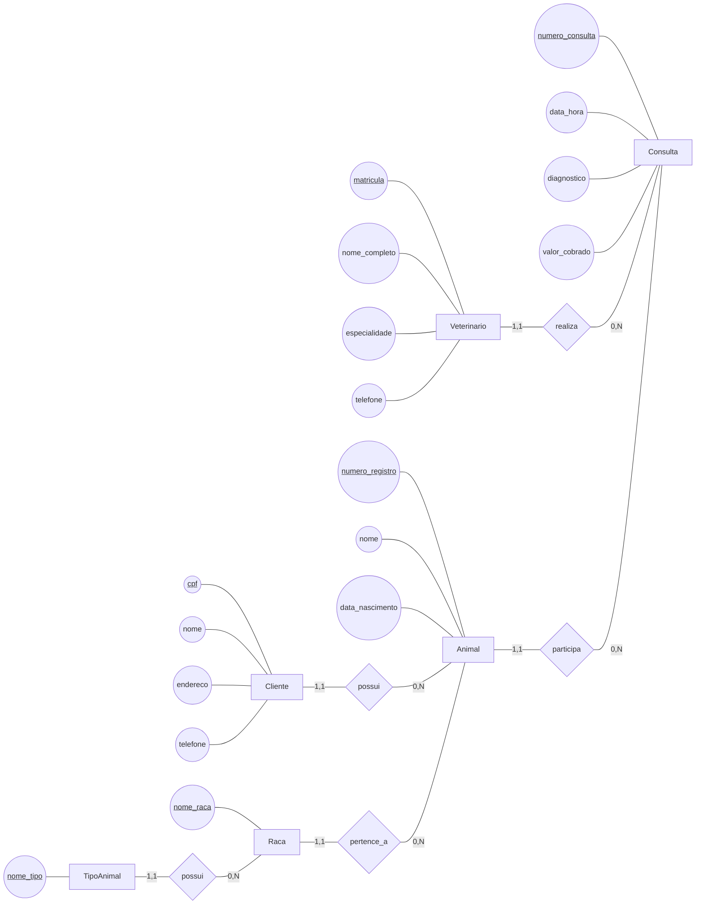
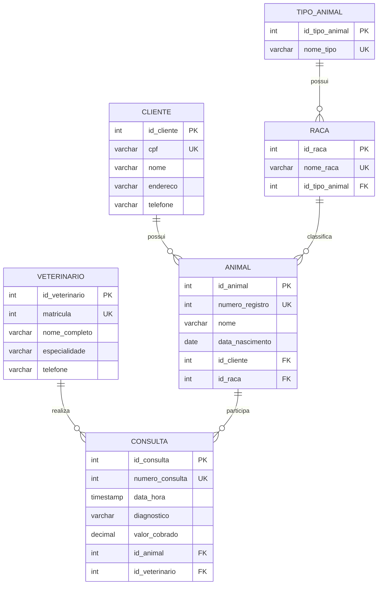

# Respostas da Dinâmica 6

## 1. Revisão do modelo conceitual

O modelo original da clínica veterinária armazenava `raca` e `tipo_animal` diretamente em `Animal`. Para a revisão, considera-se a dependência funcional:

```text
raca -> tipo_animal
```

Ou seja, uma raça determina um único tipo de animal. Se o tipo continuar armazenado em cada registro de `Animal`, a informação será repetida para vários animais da mesma raça e haverá uma dependência transitiva:

```text
Animal -> raca -> tipo_animal
```

Para eliminar essa repetição, `TipoAnimal` e `Raca` passam a ser conceitos próprios. `Raca` pertence a um `TipoAnimal`, e `Animal` referencia sua `Raca`. O tipo do animal pode ser obtido por meio do relacionamento entre `Raca` e `TipoAnimal`.

### Diagrama conceitual revisado



### Entidades, atributos e tipos conceituais

| Entidade | Atributo | Tipo | Identificador do domínio |
|---|---|---|:---:|
| Veterinario | matricula | INTEGER | Sim |
| Veterinario | nome_completo | VARCHAR(120) | Não |
| Veterinario | especialidade | VARCHAR(80) | Não |
| Veterinario | telefone | VARCHAR(20) | Não |
| Cliente | cpf | VARCHAR(14) | Sim |
| Cliente | nome | VARCHAR(120) | Não |
| Cliente | endereco | VARCHAR(200) | Não |
| Cliente | telefone | VARCHAR(20) | Não |
| TipoAnimal | nome_tipo | VARCHAR(40) | Sim |
| Raca | nome_raca | VARCHAR(80) | Sim |
| Animal | numero_registro | INTEGER | Sim |
| Animal | nome | VARCHAR(80) | Não |
| Animal | data_nascimento | DATE | Não |
| Consulta | numero_consulta | INTEGER | Sim |
| Consulta | data_hora | TIMESTAMP | Não |
| Consulta | diagnostico | VARCHAR(500) | Não |
| Consulta | valor_cobrado | DECIMAL(10,2) | Não |

### Relacionamentos e cardinalidades

| Relacionamento | Cardinalidade | Interpretação |
|---|---|---|
| `Veterinario realiza Consulta` | Veterinario `(1,1)` — Consulta `(0,N)` | Um veterinário pode realizar várias consultas; cada consulta possui exatamente um veterinário responsável. |
| `Cliente possui Animal` | Cliente `(1,1)` — Animal `(0,N)` | Um cliente pode possuir vários animais; cada animal pertence a exatamente um cliente. |
| `TipoAnimal possui Raca` | TipoAnimal `(1,1)` — Raca `(0,N)` | Um tipo pode possuir várias raças; cada raça pertence a um único tipo. |
| `Raca pertence_a Animal` | Raca `(1,1)` — Animal `(0,N)` | Uma raça pode classificar vários animais; cada animal possui uma única raça. |
| `Animal participa Consulta` | Animal `(1,1)` — Consulta `(0,N)` | Um animal pode participar de várias consultas; cada consulta envolve exatamente um animal. |

O `tipo_animal` não é mais um atributo de `Animal`. Ele é determinado pela raça associada ao animal.

## 2. Análise das formas normais

### Primeira Forma Normal (1FN)

O modelo revisado está na 1FN porque cada coluna armazena um único valor e não existem listas ou grupos repetidos. Os telefones são tratados como valores simples no cadastro original da clínica, e os demais atributos são atômicos.

### Segunda Forma Normal (2FN)

As tabelas do modelo lógico utilizam chaves primárias artificiais simples. Portanto, nenhum atributo não chave pode depender apenas de parte de uma chave composta. Além disso, os atributos da consulta dependem de `id_consulta`, os atributos do animal dependem de `id_animal` e os atributos da raça dependem de `id_raca`.

### Terceira Forma Normal (3FN)

No modelo original, `tipo_animal` dependia de `raca`, e não diretamente do animal. Isso criava uma dependência transitiva. No modelo revisado:

- `animal` armazena apenas a chave da raça;
- `raca` armazena a chave do tipo de animal;
- `tipo_animal` armazena o nome do tipo.

Assim, cada informação fica na entidade que determina seu valor, e não há repetição de `nome_tipo` em todos os animais da mesma raça.

## 3. Modelo lógico normalizado

Cada entidade origina uma tabela com chave primária artificial. Os identificadores de domínio continuam presentes e recebem restrição `UNIQUE`:

- `Veterinario.matricula`;
- `Cliente.cpf`;
- `TipoAnimal.nome_tipo`;
- `Raca.nome_raca`;
- `Animal.numero_registro`;
- `Consulta.numero_consulta`.

As relações 1:N são implementadas pelas seguintes chaves estrangeiras:

- `raca.id_tipo_animal` referencia `tipo_animal.id_tipo_animal`;
- `animal.id_raca` referencia `raca.id_raca`;
- `animal.id_cliente` referencia `cliente.id_cliente`;
- `consulta.id_animal` referencia `animal.id_animal`;
- `consulta.id_veterinario` referencia `veterinario.id_veterinario`.



Para descobrir o tipo de um animal, basta consultar `animal`, juntar com `raca` por `id_raca` e depois juntar com `tipo_animal` por `id_tipo_animal`. O tipo não precisa ser repetido na tabela `animal`.

### Comparação com o modelo original

| Modelo original | Modelo revisado |
|---|---|
| `Animal` armazenava `raca` e `tipo_animal` diretamente. | `Animal` referencia `Raca`; `Raca` referencia `TipoAnimal`. |
| O tipo do animal era repetido em vários registros. | O nome do tipo é armazenado uma única vez. |
| Alterar o nome de um tipo exigia atualizar vários animais. | A alteração ocorre apenas em `tipo_animal`. |
| Havia a dependência transitiva `Animal → Raca → TipoAnimal`. | A dependência foi separada em tabelas próprias. |

## 4. Modelo físico — script SQL

Script compatível com PostgreSQL. As tabelas são criadas na ordem das dependências para que todas as chaves estrangeiras possam ser definidas corretamente.

```sql
-- Modelo físico normalizado da Clínica Veterinária

CREATE TABLE veterinario (
    id_veterinario SERIAL PRIMARY KEY,
    matricula INTEGER NOT NULL UNIQUE,
    nome_completo VARCHAR(120) NOT NULL,
    especialidade VARCHAR(80) NOT NULL,
    telefone VARCHAR(20) NOT NULL
);

CREATE TABLE cliente (
    id_cliente SERIAL PRIMARY KEY,
    cpf VARCHAR(14) NOT NULL UNIQUE,
    nome VARCHAR(120) NOT NULL,
    endereco VARCHAR(200) NOT NULL,
    telefone VARCHAR(20) NOT NULL
);

CREATE TABLE tipo_animal (
    id_tipo_animal SERIAL PRIMARY KEY,
    nome_tipo VARCHAR(40) NOT NULL UNIQUE
);

CREATE TABLE raca (
    id_raca SERIAL PRIMARY KEY,
    nome_raca VARCHAR(80) NOT NULL UNIQUE,
    id_tipo_animal INTEGER NOT NULL,
    CONSTRAINT fk_raca_tipo_animal
        FOREIGN KEY (id_tipo_animal)
        REFERENCES tipo_animal (id_tipo_animal)
        ON DELETE RESTRICT
        ON UPDATE CASCADE
);

CREATE TABLE animal (
    id_animal SERIAL PRIMARY KEY,
    numero_registro INTEGER NOT NULL UNIQUE,
    nome VARCHAR(80) NOT NULL,
    data_nascimento DATE NOT NULL,
    id_cliente INTEGER NOT NULL,
    id_raca INTEGER NOT NULL,
    CONSTRAINT fk_animal_cliente
        FOREIGN KEY (id_cliente)
        REFERENCES cliente (id_cliente)
        ON DELETE RESTRICT
        ON UPDATE CASCADE,
    CONSTRAINT fk_animal_raca
        FOREIGN KEY (id_raca)
        REFERENCES raca (id_raca)
        ON DELETE RESTRICT
        ON UPDATE CASCADE
);

CREATE TABLE consulta (
    id_consulta SERIAL PRIMARY KEY,
    numero_consulta INTEGER NOT NULL UNIQUE,
    data_hora TIMESTAMP NOT NULL,
    diagnostico VARCHAR(500) NOT NULL,
    valor_cobrado NUMERIC(10,2) NOT NULL CHECK (valor_cobrado >= 0),
    id_animal INTEGER NOT NULL,
    id_veterinario INTEGER NOT NULL,
    CONSTRAINT fk_consulta_animal
        FOREIGN KEY (id_animal)
        REFERENCES animal (id_animal)
        ON DELETE RESTRICT
        ON UPDATE CASCADE,
    CONSTRAINT fk_consulta_veterinario
        FOREIGN KEY (id_veterinario)
        REFERENCES veterinario (id_veterinario)
        ON DELETE RESTRICT
        ON UPDATE CASCADE
);
```

As chaves estrangeiras preservam os relacionamentos do modelo conceitual e impedem referências a clientes, raças, tipos, animais ou veterinários inexistentes. A separação de `Raca` e `TipoAnimal` evita a repetição do tipo e elimina a dependência transitiva que existia no modelo original.
